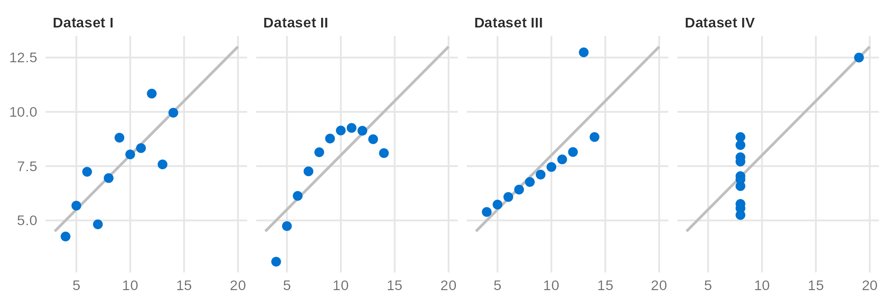
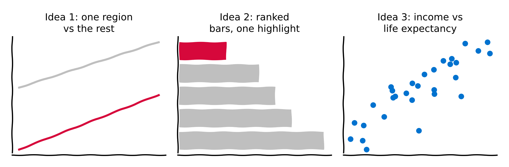

# The design process {.unnumbered}

::: {.callout-tip}
#### Learning objectives

- Explain the difference between exploratory and explanatory figures.
- Describe a design process that starts with the message and the audience.
- Use five questions to critique any figure.
:::

## Two jobs for a figure

Figures do one of two jobs.

**Exploring** is for you. You make many quick, rough plots to find out what is in your data. Default settings are fine, and speed matters more than beauty.

**Explaining** is for someone else. You have found something, and you design one figure to show it clearly, without you there to talk it through.

The most common problem in papers and talks is an exploratory plot shown to an audience as if it were an explanatory figure: default settings, no clear message, and the reader left to work it out.

## Why we always explore first

The four small datasets below have the same means, variances, correlation and fitted regression line, to two decimal places [@anscombe1973]. Summarised as numbers they look identical. Plotted, they tell four completely different stories.

::: {.hero}

:::

Summary statistics compress your data, and the compression can hide exactly what matters: curves, outliers and clusters. Plot first, then summarise, model or test.

## A process for explanatory figures

Most of the work of a good figure happens before any code is written.

::: {.process}
Question&rarr;
Explore&rarr;
Message&rarr;
Audience&rarr;
Sketch&rarr;
Build&rarr;
Critique&#8635;
:::

1. **Question and explore.** What are you asking, and what does the data actually look like? Chapters 2 to 4 cover this.
2. **Message.** Write the message as one sentence: a *headline*, not a label. "Life expectancy by region" is a label. "Sub-Saharan Africa trails every other region by over 10 years" is a headline. If you cannot write the sentence, the figure cannot show it.
3. **Audience.** A reader of your paper can study a figure for minutes. A conference audience sees your slide for thirty seconds while listening to you. A public audience may not know your field's conventions. The audience decides how much detail, how much text and how big.
4. **Sketch.** Draw two or three versions on paper before opening any software. It takes five minutes and stops you spending an hour perfecting the wrong chart.
5. **Build.** Only now do you write code. Chapters 5 to 9 cover the techniques.
6. **Critique.** Show it to someone, ask what they take away, and go round again.

## Choose the chart by the question

Most research figures answer one of five questions. Choose the question first, then the chart.

| Question | What the reader compares | Typical charts | Chapter |
|---|---|---|---|
| **Distribution** | How values are spread | Histogram, box plot, violin, dots | [Distributions](materials/distributions.qmd) |
| **Comparison** | Which is bigger, and the order | Sorted bar, dot plot, lollipop | [Ranking](materials/ranking.qmd) |
| **Relationship** | Whether one goes with another | Scatter plot, heatmap | [Relationships](materials/relationships.qmd) |
| **Change** | How something moves over time | Line, small multiples | [Change over time](materials/change-over-time.qmd) |
| **Part to whole** | What share each part is | Stacked bar, sometimes a pie | [Ranking](materials/ranking.qmd) |

## How we read figures

We read some visual properties more accurately than others. In classic experiments, people judged values most accurately from **position along a common scale**, then length, then angle and area, with colour intensity least accurate [@cleveland1984]. That is why a sorted bar chart beats a pie chart for comparing similar values.

Colour, on the other hand, is seen *before* we consciously look. A single strong colour among grey draws the eye instantly. That makes colour the best tool for directing attention, and the worst for reading exact values. A recent review of the evidence is given by @franconeri2021.

## Five questions for any figure

Use these to check your own figures and to give feedback to others. Work through them in order: there is no point discussing colours if the message is unclear.

::: {.five-q}
- **Message.** What should someone take away in five seconds?
- **Audience.** Who is it for, and what do they already know?
- **Chart.** Does the chart type fit the question?
- **Attention.** Where does the eye go first? Is that where the message is?
- **Integrity.** Is it honest, readable at its final size, and accessible?
:::

::: {.callout-important}
#### The five-second test

Show your figure to someone for five seconds, then hide it. Ask what they remember. If it is not your headline, the figure needs work.
:::

## Summary

::: {.callout-tip}
#### Key points

- Exploratory figures are for you; explanatory figures are for your reader. Different rules apply.
- Always plot the data before summarising it.
- Write the headline first, then design the figure to show it.
- Choose the chart by the question: distribution, comparison, relationship, change or part to whole.
- Test figures with the five questions and a fresh pair of eyes.
:::
