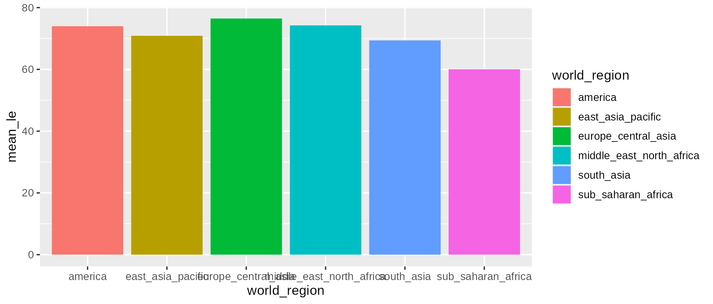
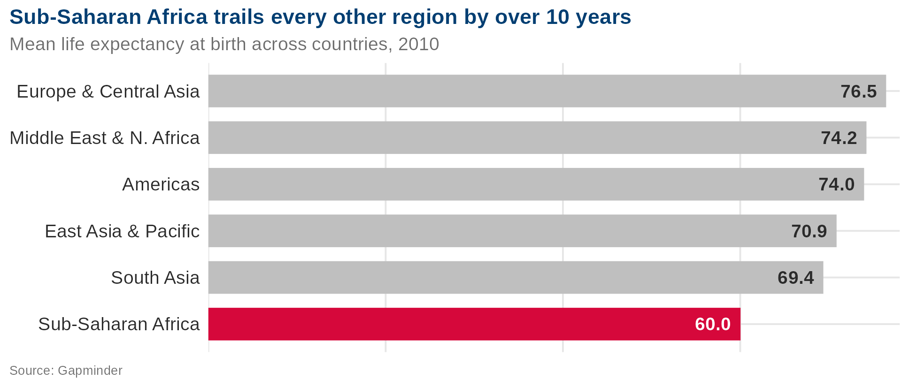
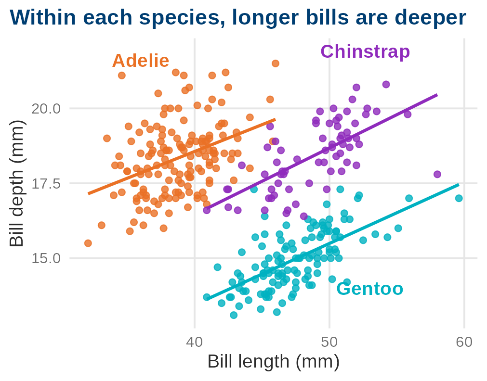
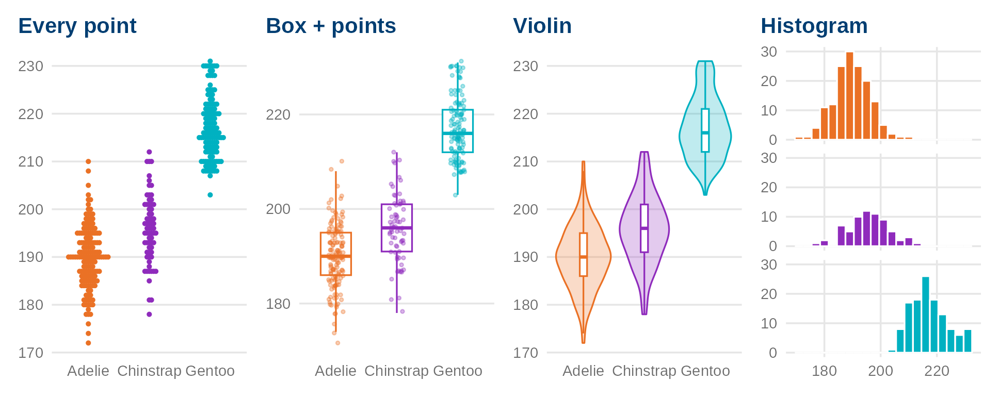
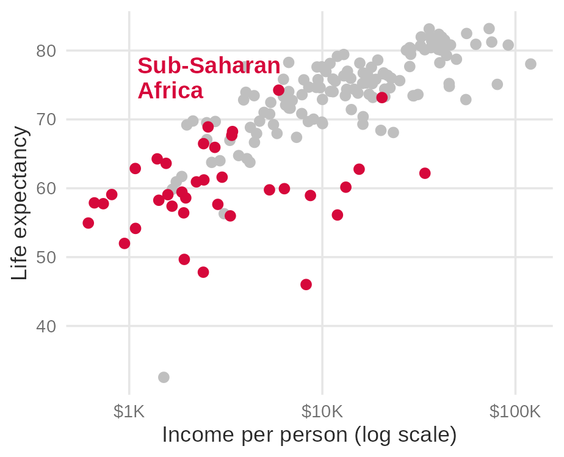
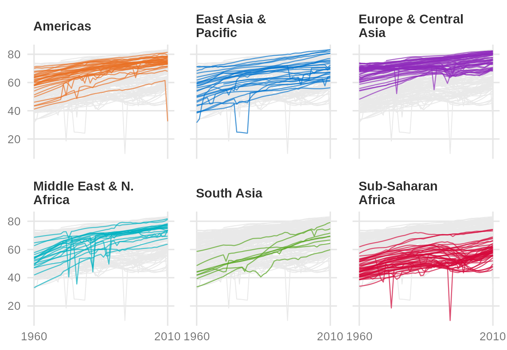

# Welcome {.unnumbered}

::: {.before-after}
<div><span class="chip before">Before</span>



Default settings.</div>
<div><span class="chip after">After</span>



Same data, designed around one message.</div>
:::

By the end of this course you will be able to make changes like this one, in R or Python, and explain every decision.

## Overview

A good figure lets someone understand your result in seconds. A poor one hides it, misleads, or simply gets skipped. This course teaches you to design figures with a purpose, and to build them in **R** (with ggplot2) or **Python** (with plotnine).

We start from the message and the audience, not the software. You will learn how to choose a chart that fits your question, how to use colour, ordering and labelling to direct attention, and how to produce figures that are honest, accessible and reproducible.

::: {.callout-tip}
#### Learning objectives

- Distinguish between figures for exploring data and figures for explaining it.
- Choose a chart type that fits your question and your audience.
- Use colour, ordering and labelling to direct attention to your message.
- Build, refine and export figures in layers using ggplot2 or plotnine.
- Critique any figure using five simple questions.
:::

## Course map

The materials follow the same path as a figure: understand the data, design for the reader, then finish the figure properly.

```{=html}
<div class="course-map">
  <a class="card-link" href="materials/building-a-plot.html"><div class="map-card"><div><div class="map-title">Foundations</div><p>Build any plot in layers with the grammar of graphics.</p></div></div></a>
  <a class="card-link" href="materials/distributions.html"><div class="map-card"><div><div class="map-title">Explore your data</div><p>Distributions, relationships and change over time.</p></div></div></a>
  <a class="card-link" href="materials/ranking.html"><div class="map-card"><div><div class="map-title">Design for attention</div><p>Ordering, colour, labels and annotation.</p></div></div></a>
  <a class="card-link" href="materials/scales-and-axes.html"><div class="map-card"><div><div class="map-title">Finish your figures</div><p>Honest axes, multi-panel figures, export and a final makeover.</p></div></div></a>
</div>
```


## How to use these materials

Every code example is available in **R** and **Python**. Use the tabs above each code block to switch; your choice is remembered across pages.

Each chapter has the same structure:

- **Learning objectives** at the top, so you know where you are heading.
- Short explanations with worked examples you can copy and run.
- **Exercises** marked by level, from one star (getting started) to three stars (more challenging).
- Sections marked <span class="badge-core">Core</span> are needed for later chapters. Sections marked <span class="badge-ext">Extension</span> are optional, for when you finish early or want to go further.
- **Key points** at the end, for quick revision.

### Ways this course is taught

| Format | What happens | Materials used |
|---|---|---|
| Half-day course | Talks and small group discussion of design principles | Slides; this site for further practice |
| Full-day course | Short talks alternating with four practical sessions | Slides and every chapter of this site |
| Workshop (3 hours) | A talk, peer feedback on your own figures, then a makeover sprint | Slides, the [checklist](reference/checklist.qmd) and [recipes](reference/recipes.qmd) |

The materials also work for self-study. Start with [The design process](design-process.qmd), then work through the chapters in order.

## Target audience

Researchers at any stage who need to communicate data: PhD students, postdocs and staff, from any discipline. The examples use social, health and biological data so that nobody needs specialist knowledge to follow them.

## Prerequisites

A basic working knowledge of either R or Python: you should be able to read a data file and run a few lines of code. If you are new to programming, CRIT runs introductory courses in both languages several times a year; see the [course timetable](https://www.training.cam.ac.uk/bioinformatics/Event-timetable).

## Authors

- **Camice Revier** \
  _Affiliation_: Cambridge Centre for Research Informatics Training, University of Cambridge \
  _Roles_: conceptualisation; writing (redesign of the course and materials); coding

This version is a redesign of the original course by:

- **Martin van Rongen** \
  _Affiliation_: Bioinformatics Training Facility, University of Cambridge \
  _Roles_: writing (original draft); conceptualisation; coding
- **Hugo Tavares** \
  _Affiliation_: Bioinformatics Training Facility, University of Cambridge \
  _Roles_: writing (review and editing); coding
- **Matt Castle** \
  _Affiliation_: Bioinformatics Training Facility, University of Cambridge \
  _Roles_: conceptualisation

## Data

The course uses three openly available datasets:

- **Palmer penguins**: body measurements for three penguin species [@horst2020].
- **Gapminder**: socioeconomic and health indicators by country, 1960 to 2010 [@gapminder].
- **Darwin's finches**: beak and body measurements from the Galápagos, from the earlier version of this course.
