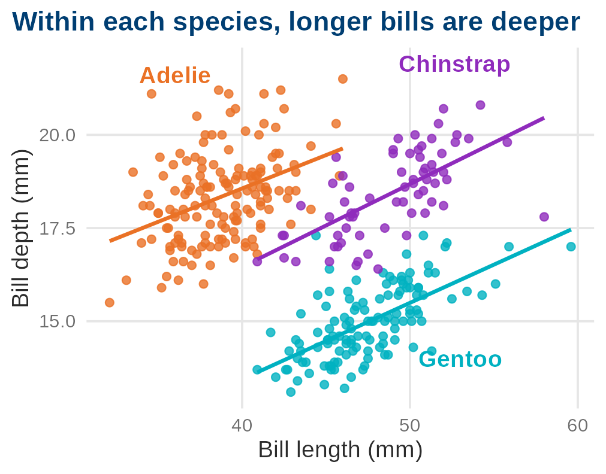

::: {.callout-tip}
#### Learning objectives

- Describe a plot as data, aesthetics and geometries.
- Build a plot one layer at a time in ggplot2 or plotnine.
- Tell the difference between *mapping* a variable and *setting* a fixed value.
- Add labels and a theme, and save a plot at a chosen size.
:::

::: {.hero}
{width=70%}
:::

## The grammar of graphics <span class="badge-core">Core</span>

Both ggplot2 (R) and plotnine (Python) are based on the *grammar of graphics* [@wickham2010]. Instead of choosing from a menu of chart types, you describe a plot in parts:

| Part | Question it answers | Example |
|---|---|---|
| **Data** | Which data frame? | `penguins` |
| **Aesthetics** (`aes`) | Which variable goes on which visual property? | bill length on x, bill depth on y |
| **Geometries** (`geom_`) | What marks are drawn? | points, lines, bars |
| **Scales** | How are values turned into positions and colours? | log axis, a colour palette |
| **Theme** | How do the non-data parts look? | fonts, grid lines, background |

You add these parts together with `+`. Change one part, and only that part of the plot changes. This makes it easy to try ideas quickly.

## Load packages and data

::: {.panel-tabset group="language"}
## R

```{r}
library(tidyverse)

penguins <- read_csv("data/penguins.csv")
head(penguins)
```

## Python

```{python}
import pandas as pd
from plotnine import *

penguins = pd.read_csv("data/penguins.csv")
penguins.head()
```
:::

Each row is one penguin. We have its species, the island it was found on, bill length and depth, flipper length, body mass, sex and the year it was measured.

## Layer 1: data and aesthetics <span class="badge-core">Core</span>

Start by saying which data to use, and which variables map to x and y.

::: {.panel-tabset group="language"}
## R

```{r}
ggplot(penguins, aes(x = bill_length_mm, y = bill_depth_mm))
```

## Python

```{python}
p = ggplot(penguins, aes(x="bill_length_mm", y="bill_depth_mm"))
p.show()
```
:::

We have axes, but no data is drawn. That is because we have not yet said *how* to draw it.

## Layer 2: a geometry <span class="badge-core">Core</span>

Add points with `geom_point()`.

::: {.panel-tabset group="language"}
## R

```{r}
ggplot(penguins, aes(x = bill_length_mm, y = bill_depth_mm)) +
  geom_point()
```

## Python

```{python}
p = (ggplot(penguins, aes(x="bill_length_mm", y="bill_depth_mm"))
     + geom_point())
p.show()
```
:::

We can add more than one geometry. Here is a straight-line trend on top of the points:

::: {.panel-tabset group="language"}
## R

```{r}
ggplot(penguins, aes(x = bill_length_mm, y = bill_depth_mm)) +
  geom_point() +
  geom_smooth(method = "lm", se = FALSE)
```

## Python

```{python}
p = (ggplot(penguins, aes(x="bill_length_mm", y="bill_depth_mm"))
     + geom_point()
     + geom_smooth(method="lm", se=False))
p.show()
```
:::

At first sight, longer bills seem to be *shallower*. Keep that in mind.

## Layer 3: mapping colour <span class="badge-core">Core</span>

Now map `species` to colour, inside `aes()`.

::: {.panel-tabset group="language"}
## R

```{r}
ggplot(penguins, aes(x = bill_length_mm, y = bill_depth_mm, colour = species)) +
  geom_point() +
  geom_smooth(method = "lm", se = FALSE)
```

## Python

```{python}
p = (ggplot(penguins, aes(x="bill_length_mm", y="bill_depth_mm", color="species"))
     + geom_point()
     + geom_smooth(method="lm", se=False))
p.show()
```
:::

Within every species, longer bills are *deeper*. The overall negative trend was created by mixing three groups with different averages. This is known as Simpson's paradox, and we found it simply by adding one aesthetic. It is a good example of why exploring your data matters: it can change your conclusion, not just your figure.

::: {.callout-important}
#### Design principle: aesthetics are inherited

Anything inside `ggplot(aes(...))` applies to every layer. That is why both the points and the trend lines were coloured by species, and why we got one trend line per species.
:::

## Mapping versus setting <span class="badge-core">Core</span>

This is the most common source of confusion for beginners.

- **Mapping** links a visual property to a variable. It goes *inside* `aes()`.
- **Setting** gives a visual property one fixed value. It goes *outside* `aes()`.

::: {.panel-tabset group="language"}
## R

```{r}
#| fig-height: 3.6
ggplot(penguins, aes(x = bill_length_mm, y = bill_depth_mm)) +
  geom_point(colour = "steelblue", size = 2, alpha = 0.6)
```

## Python

```{python}
p = (ggplot(penguins, aes(x="bill_length_mm", y="bill_depth_mm"))
     + geom_point(color="steelblue", size=2, alpha=0.6))
p.show()
```
:::

Here every point is the same blue, at the same size, partly transparent. If you accidentally write `aes(colour = "steelblue")`, the software treats `"steelblue"` as a tiny dataset with one category, and you get a legend with a single entry and a default colour. Try it to see.

## Layer 4: labels and theme <span class="badge-core">Core</span>

Readable labels and a cleaner theme make a big difference. Notice the title is a *headline*: it says what to notice.

::: {.panel-tabset group="language"}
## R

```{r}
ggplot(penguins, aes(x = bill_length_mm, y = bill_depth_mm, colour = species)) +
  geom_point(alpha = 0.8) +
  geom_smooth(method = "lm", se = FALSE) +
  labs(title = "Within each species, longer bills are deeper",
       x = "Bill length (mm)",
       y = "Bill depth (mm)",
       colour = "Species") +
  theme_minimal(base_size = 13)
```

## Python

```{python}
p = (ggplot(penguins, aes(x="bill_length_mm", y="bill_depth_mm", color="species"))
     + geom_point(alpha=0.8)
     + geom_smooth(method="lm", se=False)
     + labs(title="Within each species, longer bills are deeper",
            x="Bill length (mm)",
            y="Bill depth (mm)",
            color="Species")
     + theme_minimal(base_size=13))
p.show()
```
:::

## Saving a plot <span class="badge-core">Core</span>

Store the plot in an object, then save it with an explicit size. Set the size to how big the figure will be when it is used, not how big it looks on your screen. We cover this properly in [Multi-panel figures and export](multi-panel-and-export.qmd).

::: {.panel-tabset group="language"}
## R

```{r}
#| eval: false
p <- ggplot(penguins, aes(x = bill_length_mm, y = bill_depth_mm, colour = species)) +
  geom_point()

ggsave("figures/bills.png", p, width = 15, height = 10, units = "cm", dpi = 300)
```

## Python

```{python}
#| eval: false
p = (ggplot(penguins, aes(x="bill_length_mm", y="bill_depth_mm", color="species"))
     + geom_point())

p.save("figures/bills.png", width=15, height=10, units="cm", dpi=300)
```
:::

## Exercises

::: {.callout-exercise}
#### Flippers and body mass



Make a scatter plot of flipper length (x) against body mass (y). Add readable axis labels with units.

::: {.callout-answer collapse="true"}

::: {.panel-tabset group="language"}
## R

```{r}
ggplot(penguins, aes(x = flipper_length_mm, y = body_mass_g)) +
  geom_point() +
  labs(x = "Flipper length (mm)", y = "Body mass (g)")
```

## Python

```{python}
p = (ggplot(penguins, aes(x="flipper_length_mm", y="body_mass_g"))
     + geom_point()
     + labs(x="Flipper length (mm)", y="Body mass (g)"))
p.show()
```
:::
:::
:::

::: {.callout-exercise}
#### Map and set



Starting from your last plot:

1. Map `species` to colour.
2. Set all points to size 2.5 and transparency 0.7.
3. Add a theme of your choice, such as `theme_classic()` or `theme_bw()`.
4. Write a headline title. What is the message?

::: {.callout-answer collapse="true"}

::: {.panel-tabset group="language"}
## R

```{r}
ggplot(penguins, aes(x = flipper_length_mm, y = body_mass_g, colour = species)) +
  geom_point(size = 2.5, alpha = 0.7) +
  labs(title = "Gentoo penguins are the largest, with the longest flippers",
       x = "Flipper length (mm)", y = "Body mass (g)", colour = "Species") +
  theme_classic(base_size = 13)
```

## Python

```{python}
p = (ggplot(penguins, aes(x="flipper_length_mm", y="body_mass_g", color="species"))
     + geom_point(size=2.5, alpha=0.7)
     + labs(title="Gentoo penguins are the largest, with the longest flippers",
            x="Flipper length (mm)", y="Body mass (g)", color="Species")
     + theme_classic(base_size=13))
p.show()
```
:::

Other headlines are possible, for example "Heavier penguins have longer flippers". The point is to decide.
:::
:::

::: {.callout-exercise}
#### Shape as a second cue <span class="badge-ext">Extension</span>



Map `species` to both colour *and* shape. Why might this help some readers? What happens to the legend?

::: {.callout-answer collapse="true"}

::: {.panel-tabset group="language"}
## R

```{r}
ggplot(penguins, aes(x = flipper_length_mm, y = body_mass_g,
                     colour = species, shape = species)) +
  geom_point(size = 2.5, alpha = 0.7) +
  labs(x = "Flipper length (mm)", y = "Body mass (g)",
       colour = "Species", shape = "Species")
```

## Python

```{python}
p = (ggplot(penguins, aes(x="flipper_length_mm", y="body_mass_g",
                          color="species", shape="species"))
     + geom_point(size=2.5, alpha=0.7)
     + labs(x="Flipper length (mm)", y="Body mass (g)",
            color="Species", shape="Species"))
p.show()
```
:::

Using shape as well as colour means the groups can still be told apart in greyscale and by readers with colour vision deficiency. Because both legends have the same title, they are merged into one. Give them different titles and you get two separate legends.
:::
:::

## Summary

::: {.callout-tip}
#### Key points

- A plot is built from data, aesthetics, geometries, scales and a theme, added together with `+`.
- Variables are *mapped* inside `aes()`; fixed values are *set* outside it.
- Aesthetics in the main `ggplot()` call are inherited by every layer.
- Adding one aesthetic can change what you conclude, so explore before you explain.
- Save plots with an explicit width, height and resolution.
:::
