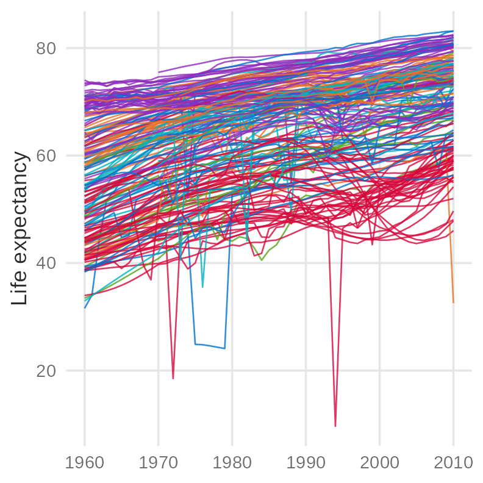
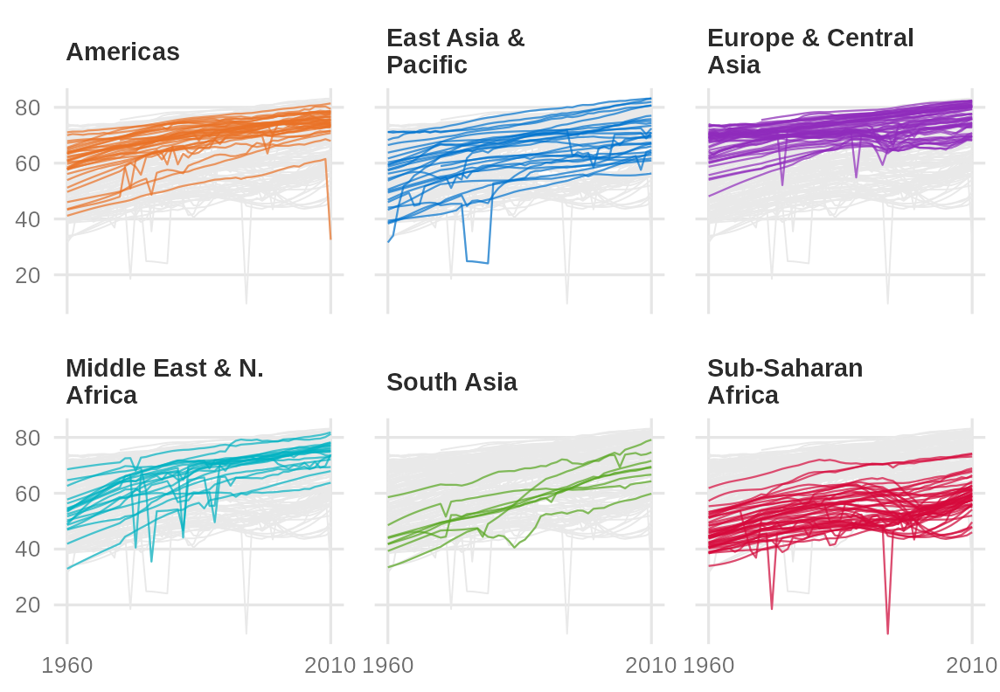

::: {.callout-tip}
#### Learning objectives

- Draw line charts for one and several time series.
- Use `group` to draw one line per unit.
- Avoid spaghetti plots by highlighting or by using small multiples.
- Summarise many series into a few.
:::

::: {.before-after}
<div><span class="chip before">Spaghetti</span>



Every country at once: nothing can be followed.</div>
<div><span class="chip after">Small multiples</span>



One panel per region, with the rest of the world in grey behind.</div>
:::

## Load packages and data

We now use Gapminder data for every year from 1960 to 2010.

::: {.panel-tabset group="language"}
## R

```{r}
library(tidyverse)

gap_years <- read_csv("data/gapminder_1960_2010.csv")
```

## Python

```{python}
import pandas as pd
from plotnine import *

gap_years = pd.read_csv("data/gapminder_1960_2010.csv")
```
:::

## One line <span class="badge-core">Core</span>

Lines connect observations in order, which suits anything measured along an ordered scale such as time. Let's look at a single country.

::: {.panel-tabset group="language"}
## R

```{r}
#| fig-height: 3.5
gap_years |>
  filter(country == "Rwanda") |>
  ggplot(aes(x = year, y = life_expectancy)) +
  geom_line(linewidth = 1, colour = "#003E72") +
  labs(x = NULL, y = "Life expectancy (years)")
```

## Python

```{python}
rwanda = gap_years[gap_years["country"] == "Rwanda"]

p = (ggplot(rwanda, aes(x="year", y="life_expectancy"))
     + geom_line(size=1, color="#003E72")
     + labs(x="", y="Life expectancy (years)")
     + theme(figure_size=(7, 3.5)))
p.show()
```
:::

The sharp fall in the early 1990s is the 1994 genocide. A line chart makes events like this obvious in a way a table never could.

::: {.callout-note}
#### Do I need an x axis label?

When the axis shows years, the label "year" adds nothing, so we removed it with `x = NULL` (R) or `x=""` (Python). Remove labels that only repeat what the tick marks already say.
:::

## Several lines <span class="badge-core">Core</span>

To draw one line per country, map `country` to `group`. Without it, the software would join all the points into one zigzag.

::: {.panel-tabset group="language"}
## R

```{r}
#| fig-height: 3.8
countries <- c("Rwanda", "Brazil", "India", "United Kingdom")

gap_years |>
  filter(country %in% countries) |>
  ggplot(aes(x = year, y = life_expectancy, colour = country)) +
  geom_line(linewidth = 1) +
  labs(x = NULL, y = "Life expectancy (years)", colour = NULL)
```

## Python

```{python}
countries = ["Rwanda", "Brazil", "India", "United Kingdom"]
four = gap_years[gap_years["country"].isin(countries)]

p = (ggplot(four, aes(x="year", y="life_expectancy", color="country"))
     + geom_line(size=1)
     + labs(x="", y="Life expectancy (years)", color="")
     + theme(figure_size=(7, 3.8)))
p.show()
```
:::

Mapping `colour` also sets the groups, so here we did not need `group` separately.

## Too many lines <span class="badge-core">Core</span>

With every country, the plot turns into spaghetti.

::: {.panel-tabset group="language"}
## R

```{r}
#| fig-height: 3.8
ggplot(gap_years, aes(x = year, y = life_expectancy, group = country)) +
  geom_line(alpha = 0.3) +
  labs(x = NULL, y = "Life expectancy (years)")
```

## Python

```{python}
p = (ggplot(gap_years, aes(x="year", y="life_expectancy", group="country"))
     + geom_line(alpha=0.3)
     + labs(x="", y="Life expectancy (years)")
     + theme(figure_size=(7, 3.8)))
p.show()
```
:::

We can see the overall trend upwards and a few dramatic dips, but we cannot follow any single country. There are three good ways out.

### Option 1: highlight a few

Draw everything in light grey for context, then draw the lines you care about on top.

::: {.panel-tabset group="language"}
## R

```{r}
#| fig-height: 3.8
focus <- gap_years |> filter(country %in% c("Rwanda", "Cambodia"))

ggplot(gap_years, aes(x = year, y = life_expectancy, group = country)) +
  geom_line(colour = "grey85") +
  geom_line(data = focus, aes(colour = country), linewidth = 1.2) +
  scale_colour_manual(values = c(Cambodia = "#EA7125", Rwanda = "#D6083B")) +
  labs(x = NULL, y = "Life expectancy (years)", colour = NULL)
```

## Python

```{python}
focus = gap_years[gap_years["country"].isin(["Rwanda", "Cambodia"])]

p = (ggplot(gap_years, aes(x="year", y="life_expectancy", group="country"))
     + geom_line(color="#D9D9D9")
     + geom_line(data=focus, mapping=aes(color="country"), size=1.2)
     + scale_color_manual(values={"Cambodia": "#EA7125", "Rwanda": "#D6083B"})
     + labs(x="", y="Life expectancy (years)", color="")
     + theme(figure_size=(7, 3.8)))
p.show()
```
:::

### Option 2: small multiples

Split the data into one panel per region with `facet_wrap()`. All panels share the same axes, so they can be compared at a glance.

::: {.panel-tabset group="language"}
## R

```{r}
#| fig-height: 5
ggplot(gap_years, aes(x = year, y = life_expectancy, group = country)) +
  geom_line(alpha = 0.4, colour = "#0072CF") +
  facet_wrap(~ region) +
  scale_x_continuous(breaks = c(1960, 1985, 2010)) +
  labs(x = NULL, y = "Life expectancy (years)")
```

## Python

```{python}
p = (ggplot(gap_years, aes(x="year", y="life_expectancy", group="country"))
     + geom_line(alpha=0.4, color="#0072CF")
     + facet_wrap("region")
     + scale_x_continuous(breaks=[1960, 1985, 2010])
     + labs(x="", y="Life expectancy (years)")
     + theme(figure_size=(7, 5)))
p.show()
```
:::

### Option 3: summarise

Sometimes the message is about groups, not individual countries. Calculate a summary per group and year, then plot a few lines.

::: {.panel-tabset group="language"}
## R

```{r}
#| fig-height: 3.8
region_means <- gap_years |>
  group_by(region, year) |>
  summarise(life_expectancy = mean(life_expectancy, na.rm = TRUE), .groups = "drop")

ggplot(region_means, aes(x = year, y = life_expectancy, colour = region)) +
  geom_line(linewidth = 1.1) +
  labs(x = NULL, y = "Mean life expectancy (years)", colour = NULL)
```

## Python

```{python}
region_means = (gap_years
                .groupby(["region", "year"], as_index=False)["life_expectancy"]
                .mean())

p = (ggplot(region_means, aes(x="year", y="life_expectancy", color="region"))
     + geom_line(size=1.1)
     + labs(x="", y="Mean life expectancy (years)", color="")
     + theme(figure_size=(7, 3.8)))
p.show()
```
:::

This is far easier to read, but remember what the summary hides: the spread between countries and events like the ones in Rwanda and Cambodia. Six lines with a legend is still hard work. In [Labels, titles and annotation](labels-and-annotation.qmd) we replace the legend with labels at the end of each line.

## Exercises

::: {.callout-exercise}
#### Income over time



Plot income per person over time for China, India and the United States. Use a log scale on the y axis. Why does a log scale make sense for growth?

::: {.callout-answer collapse="true"}

::: {.panel-tabset group="language"}
## R

```{r}
#| fig-height: 3.8
gap_years |>
  filter(country %in% c("China", "India", "United States")) |>
  ggplot(aes(x = year, y = income_per_person, colour = country)) +
  geom_line(linewidth = 1) +
  scale_y_log10(labels = scales::label_dollar(accuracy = 1)) +
  labs(x = NULL, y = "Income per person (log scale)", colour = NULL)
```

## Python

```{python}
three = gap_years[gap_years["country"].isin(["China", "India", "United States"])]

p = (ggplot(three, aes(x="year", y="income_per_person", color="country"))
     + geom_line(size=1)
     + scale_y_log10(labels=lambda breaks: [f"${b:,.0f}" for b in breaks])
     + labs(x="", y="Income per person (log scale)", color="")
     + theme(figure_size=(7, 3.8)))
p.show()
```
:::

On a log scale, a constant growth *rate* appears as a straight line, and the slope shows how fast an economy grows, whatever its starting size. China's steep slope after 1980 stands out, even though the United States is far richer throughout.
:::
:::

::: {.callout-exercise}
#### Highlight in context



Pick one region. Draw every country in the world in light grey, and the countries in your chosen region in a strong colour on top. Write a headline title.

::: {.callout-answer collapse="true"}

::: {.panel-tabset group="language"}
## R

```{r}
#| fig-height: 3.8
south_asia <- gap_years |> filter(region == "South Asia")

ggplot(gap_years, aes(x = year, y = life_expectancy, group = country)) +
  geom_line(colour = "grey85") +
  geom_line(data = south_asia, colour = "#55A51C", linewidth = 0.9) +
  labs(title = "South Asia has closed much of the gap since 1960",
       x = NULL, y = "Life expectancy (years)")
```

## Python

```{python}
south_asia = gap_years[gap_years["region"] == "South Asia"]

p = (ggplot(gap_years, aes(x="year", y="life_expectancy", group="country"))
     + geom_line(color="#D9D9D9")
     + geom_line(data=south_asia, color="#55A51C", size=0.9)
     + labs(title="South Asia has closed much of the gap since 1960",
            x="", y="Life expectancy (years)")
     + theme(figure_size=(7, 3.8)))
p.show()
```
:::
:::
:::

## Summary

::: {.callout-tip}
#### Key points

- Use lines for values measured along an ordered scale such as time.
- Map a variable to `group` (or `colour`) to draw one line per unit.
- Avoid spaghetti: highlight a few lines, use small multiples, or summarise.
- Log scales show growth rates as straight lines.
:::
