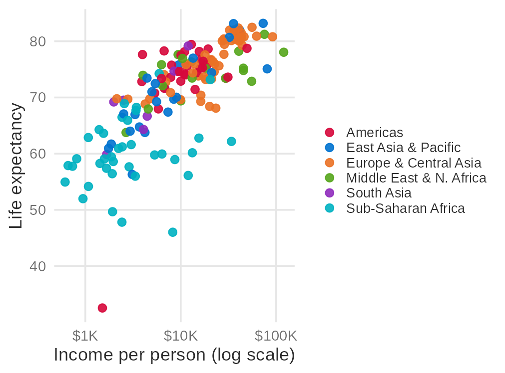
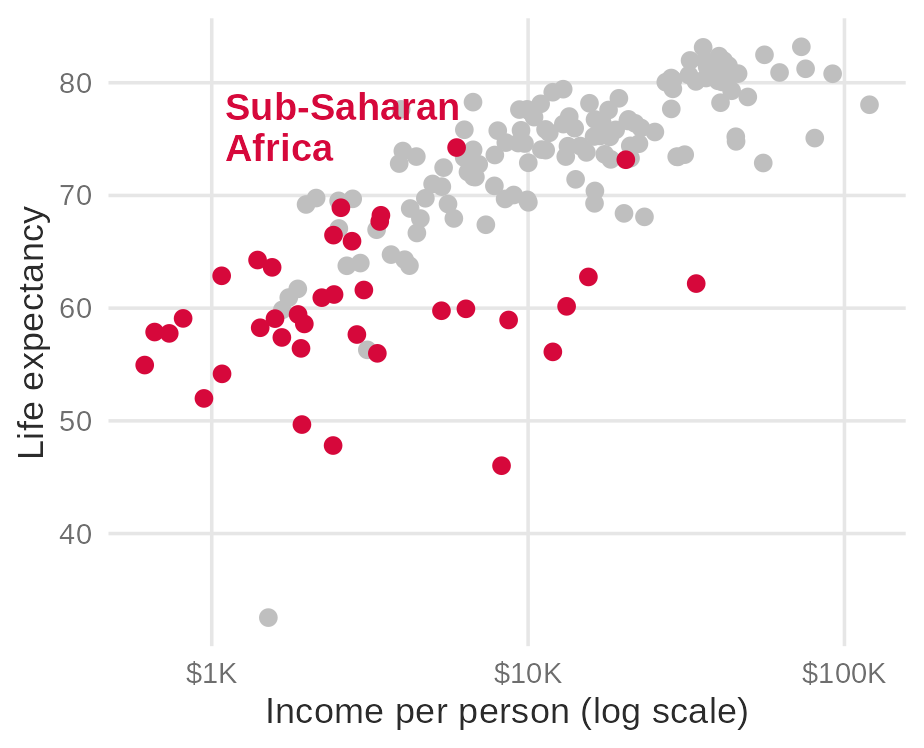
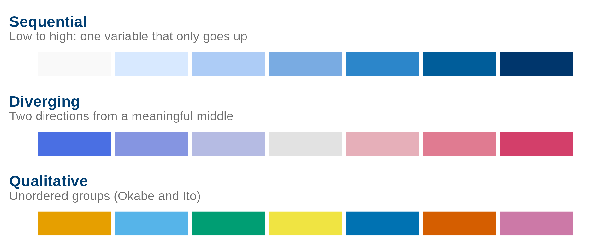
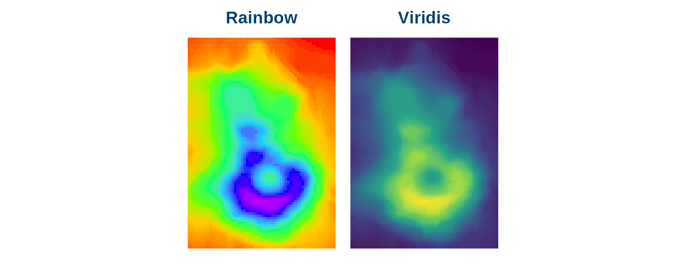
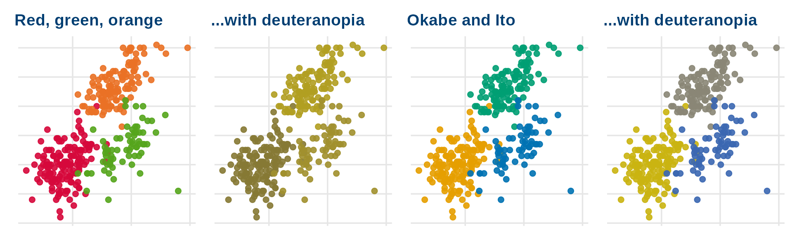

::: {.callout-tip}
#### Learning objectives

- Match the type of colour palette to the type of data.
- Replace rainbow colour maps with perceptually even ones.
- Choose colours that work for readers with colour vision deficiency.
- Use grey and a single highlight colour to direct attention.
:::

::: {.before-after}
<div><span class="chip before">Six colours</span>



Every region coloured: a legend to decode and no focus.</div>
<div><span class="chip after">One highlight</span>



Everything grey except the group the message is about.</div>
:::

## Three kinds of palette <span class="badge-core">Core</span>



| Palette | Data | Examples |
|---|---|---|
| **Sequential** | A quantity from low to high | Concentration, count, income |
| **Diverging** | Values either side of a meaningful midpoint | Change from baseline, correlation, temperature anomaly |
| **Qualitative** | Unordered categories | Species, treatment, region |

Using the wrong kind misleads the reader. A qualitative palette on a numeric variable suggests categories that do not exist; a sequential palette on categories suggests an order that does not exist.

## Load packages and data

::: {.panel-tabset group="language"}
## R

```{r}
library(tidyverse)

gapminder <- read_csv("data/gapminder_2010.csv")
penguins <- read_csv("data/penguins.csv")
```

## Python

```{python}
import pandas as pd
from plotnine import *

gapminder = pd.read_csv("data/gapminder_2010.csv")
penguins = pd.read_csv("data/penguins.csv")
```
:::

## Qualitative colours you choose <span class="badge-core">Core</span>

The default colours are designed to be evenly spaced in hue, not to be easy to tell apart for everyone. The Okabe and Ito palette was designed to remain distinguishable for people with the common forms of colour vision deficiency [@okabe2008]. Set your own colours with `scale_colour_manual()`.

::: {.panel-tabset group="language"}
## R

```{r}
okabe_ito <- c("#E69F00", "#56B4E9", "#009E73", "#F0E442",
               "#0072B2", "#D55E00", "#CC79A7", "#000000")

ggplot(penguins, aes(x = bill_length_mm, y = flipper_length_mm, colour = species)) +
  geom_point(size = 2, alpha = 0.8) +
  scale_colour_manual(values = okabe_ito) +
  labs(x = "Bill length (mm)", y = "Flipper length (mm)", colour = "Species")
```

## Python

```{python}
okabe_ito = ["#E69F00", "#56B4E9", "#009E73", "#F0E442",
             "#0072B2", "#D55E00", "#CC79A7", "#000000"]

p = (ggplot(penguins, aes(x="bill_length_mm", y="flipper_length_mm", color="species"))
     + geom_point(size=2, alpha=0.8)
     + scale_color_manual(values=okabe_ito)
     + labs(x="Bill length (mm)", y="Flipper length (mm)", color="Species"))
p.show()
```
:::

To give specific colours to specific groups, use a *named* vector (R) or dictionary (Python), for example `c(Adelie = "#E69F00", ...)`. Then the colours stay the same in every figure, even if a group is missing from one of them.

## Sequential colours and viridis <span class="badge-core">Core</span>

For a continuous variable, use a palette that changes evenly in lightness. The viridis family was designed for this: it is perceptually even, works in greyscale, and is readable with colour vision deficiency.

::: {.panel-tabset group="language"}
## R

```{r}
ggplot(gapminder, aes(x = income_per_person, y = life_expectancy, colour = child_mortality)) +
  geom_point(size = 2.5) +
  scale_x_log10(labels = scales::label_dollar(accuracy = 1)) +
  scale_colour_viridis_c(direction = -1) +
  labs(x = "Income per person (log scale)", y = "Life expectancy (years)",
       colour = "Child deaths\nper 1,000")
```

## Python

```{python}
p = (ggplot(gapminder, aes(x="income_per_person", y="life_expectancy", color="child_mortality"))
     + geom_point(size=2.5)
     + scale_x_log10(labels=lambda breaks: [f"${b:,.0f}" for b in breaks])
     + scale_color_cmap("viridis_r")
     + labs(x="Income per person (log scale)", y="Life expectancy (years)",
            color="Child deaths\nper 1,000"))
p.show()
```
:::

We reversed the palette so that darker means *more* child deaths, which matches how most people read darkness.

### Why not a rainbow?

Rainbow colour maps change lightness unevenly, so we see sharp boundaries where the data changes smoothly, and they fail for colour vision deficiency [@crameri2020]. The two maps below show the same smooth surface.

{width=80%}

## Diverging colours <span class="badge-core">Core</span>

A diverging palette uses two hues meeting at a neutral midpoint. It is right when the midpoint means something, such as zero change or zero correlation. Here is a correlation matrix of the Gapminder variables.

::: {.panel-tabset group="language"}
## R

```{r}
#| fig-height: 4.6
vars <- c("children_per_woman", "child_mortality", "life_expectancy",
          "income_per_person", "population")

cor_long <- cor(gapminder[vars]) |>
  as_tibble(rownames = "var1") |>
  pivot_longer(-var1, names_to = "var2", values_to = "r")

ggplot(cor_long, aes(x = var1, y = var2, fill = r)) +
  geom_tile(colour = "white") +
  geom_text(aes(label = round(r, 2)), size = 3.5) +
  scale_fill_gradient2(low = "#0072B2", mid = "white", high = "#D55E00",
                       midpoint = 0, limits = c(-1, 1)) +
  labs(x = NULL, y = NULL, fill = "Correlation") +
  theme(axis.text.x = element_text(angle = 30, hjust = 1))
```

## Python

```{python}
vars_ = ["children_per_woman", "child_mortality", "life_expectancy",
         "income_per_person", "population"]

cor_long = (gapminder[vars_].corr()
            .reset_index(names="var1")
            .melt(id_vars="var1", var_name="var2", value_name="r"))
cor_long["label"] = cor_long["r"].round(2)

p = (ggplot(cor_long, aes(x="var1", y="var2", fill="r"))
     + geom_tile(color="white")
     + geom_text(aes(label="label"), size=9)
     + scale_fill_gradient2(low="#0072B2", mid="white", high="#D55E00",
                            midpoint=0, limits=(-1, 1))
     + labs(x="", y="", fill="Correlation")
     + theme(axis_text_x=element_text(rotation=30, ha="right"),
             figure_size=(7, 4.6)))
p.show()
```
:::

Setting `limits` to -1 and 1 keeps white at exactly zero, so the colours are honest even if the strongest correlation is only 0.6.

## Grey first, then highlight <span class="badge-core">Core</span>

This is the most useful colour technique for explanatory figures. Make everything grey, then add one strong colour only where you want attention. Create a true or false column for the group of interest, and map colour to it.

::: {.panel-tabset group="language"}
## R

```{r}
gapminder |>
  mutate(focus = region == "Sub-Saharan Africa") |>
  arrange(focus) |>
  ggplot(aes(x = income_per_person, y = life_expectancy, colour = focus)) +
  geom_point(size = 2.5) +
  scale_colour_manual(values = c("grey75", "#D6083B"), guide = "none") +
  annotate("text", x = 1000, y = 77, label = "Sub-Saharan Africa",
           colour = "#D6083B", fontface = "bold", hjust = 0) +
  scale_x_log10(labels = scales::label_dollar(accuracy = 1)) +
  labs(x = "Income per person (log scale)", y = "Life expectancy (years)") +
  theme_minimal()
```

## Python

```{python}
gapminder["focus"] = gapminder["region"] == "Sub-Saharan Africa"
ordered = gapminder.sort_values("focus")

p = (ggplot(ordered, aes(x="income_per_person", y="life_expectancy", color="focus"))
     + geom_point(size=2.5)
     + scale_color_manual(values=["#BFBFBF", "#D6083B"], guide=None)
     + annotate("text", x=1000, y=77, label="Sub-Saharan Africa",
                color="#D6083B", fontweight="bold", ha="left")
     + scale_x_log10(labels=lambda breaks: [f"${b:,.0f}" for b in breaks])
     + labs(x="Income per person (log scale)", y="Life expectancy (years)")
     + theme_minimal())
p.show()
```
:::

Two details make this work. Sorting by `focus` draws the highlighted points last, so they sit on top of the grey ones. And the label is written on the plot in the highlight colour, so there is no legend to decode.

## Check for colour vision deficiency <span class="badge-ext">Extension</span>

About 1 in 12 men and 1 in 200 women have some form of colour vision deficiency, most often difficulty telling red from green. Check your figures with a simulator.



::: {.panel-tabset group="language"}
## R

The colorspace package can simulate how a set of colours looks with each type of colour vision deficiency.

```{r}
#| fig-height: 2.5
library(colorspace)

my_colours <- c("#D6083B", "#55A51C", "#EA7125")
swatchplot("Original" = my_colours,
           "Deuteranopia" = deutan(my_colours),
           "Protanopia" = protan(my_colours))
```

## Python

There is no simulator built into plotnine. Save your figure and check it with a free online tool such as [Coblis](https://www.color-blindness.com/coblis-color-blindness-simulator/), or install the `colorspacious` package to simulate colours in code.
:::

The simplest protection is not to rely on colour alone: add direct labels, or use shape as a second cue.

## Exercises

::: {.callout-exercise}
#### Name your colours



Plot penguin bill length against bill depth, coloured by species, using a named set of three colours of your choice from the Okabe and Ito palette.

::: {.callout-answer collapse="true"}

::: {.panel-tabset group="language"}
## R

```{r}
species_cols <- c(Adelie = "#E69F00", Chinstrap = "#CC79A7", Gentoo = "#009E73")

ggplot(penguins, aes(x = bill_length_mm, y = bill_depth_mm, colour = species)) +
  geom_point(size = 2) +
  scale_colour_manual(values = species_cols) +
  labs(x = "Bill length (mm)", y = "Bill depth (mm)", colour = NULL)
```

## Python

```{python}
species_cols = {"Adelie": "#E69F00", "Chinstrap": "#CC79A7", "Gentoo": "#009E73"}

p = (ggplot(penguins, aes(x="bill_length_mm", y="bill_depth_mm", color="species"))
     + geom_point(size=2)
     + scale_color_manual(values=species_cols)
     + labs(x="Bill length (mm)", y="Bill depth (mm)", color=""))
p.show()
```
:::
:::
:::

::: {.callout-exercise}
#### Highlight one species



Remake the plot so that only Gentoo penguins are coloured, with the others in light grey. Label the group directly instead of using a legend, and write a headline.

::: {.callout-answer collapse="true"}

::: {.panel-tabset group="language"}
## R

```{r}
penguins |>
  mutate(focus = species == "Gentoo") |>
  arrange(focus) |>
  ggplot(aes(x = bill_length_mm, y = bill_depth_mm, colour = focus)) +
  geom_point(size = 2) +
  scale_colour_manual(values = c("grey80", "#009E73"), guide = "none") +
  annotate("text", x = 55, y = 14, label = "Gentoo", colour = "#009E73",
           fontface = "bold", hjust = 1) +
  labs(title = "Gentoo penguins have long but shallow bills",
       x = "Bill length (mm)", y = "Bill depth (mm)") +
  theme_minimal()
```

## Python

```{python}
penguins["focus"] = penguins["species"] == "Gentoo"

p = (ggplot(penguins.sort_values("focus"),
            aes(x="bill_length_mm", y="bill_depth_mm", color="focus"))
     + geom_point(size=2)
     + scale_color_manual(values=["#CCCCCC", "#009E73"], guide=None)
     + annotate("text", x=55, y=14, label="Gentoo", color="#009E73",
                fontweight="bold", ha="right")
     + labs(title="Gentoo penguins have long but shallow bills",
            x="Bill length (mm)", y="Bill depth (mm)")
     + theme_minimal())
p.show()
```
:::
:::
:::

## Summary

::: {.callout-tip}
#### Key points

- Sequential palettes for amounts, diverging palettes around a meaningful midpoint, qualitative palettes for categories.
- Avoid rainbow colour maps; use viridis or similar.
- Choose colour-blind safe colours, and never rely on colour alone.
- Grey everything first, then highlight what matters.
:::
