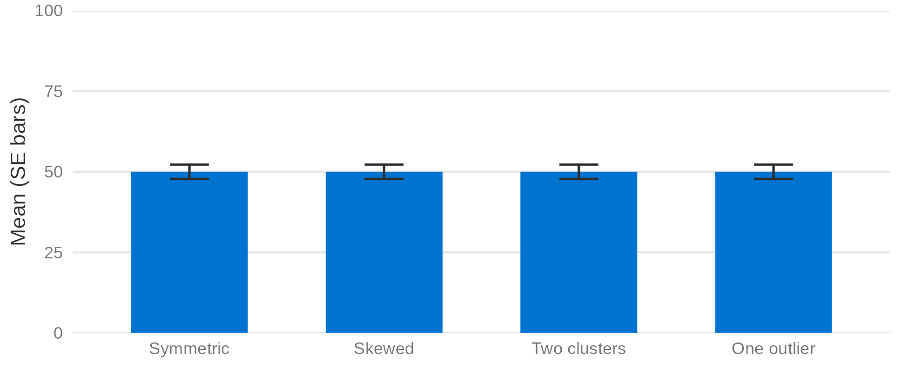
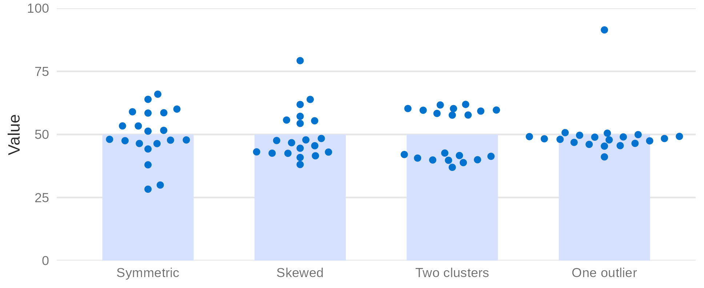
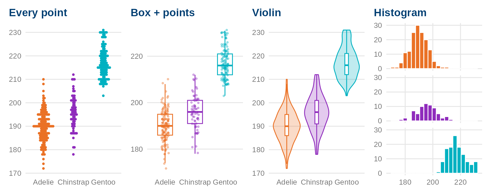

::: {.callout-tip}
#### Learning objectives

- Show how values are spread using histograms, density plots, box plots and violins.
- Explain why a bar chart of means can hide important patterns.
- Choose a distribution plot based on sample size and the number of groups.
:::

::: {.before-after}
<div><span class="chip before">Hides the data</span>



Four groups with identical means and standard errors.</div>
<div><span class="chip after">Shows the data</span>



The same four groups: symmetric, skewed, two clusters and one outlier.</div>
:::

## Why distributions matter

A mean is one number. It cannot tell you whether values are symmetric or skewed, whether there are clusters, or whether one extreme value is pulling everything along. The two figures above show four groups with the same mean and standard error. As bars they look identical. As dots, they are completely different.

Bar charts of means with error bars are still common for continuous data, despite hiding exactly these patterns [@weissgerber2015]. This chapter shows better options.

## Load packages and data

We use the finches data: beak and body measurements of Darwin's finches, in four groups defined by when they were sampled (early or late) and beak shape (blunt or pointed).

::: {.panel-tabset group="language"}
## R

```{r}
library(tidyverse)

finches <- read_csv("data/finches.csv")
penguins <- read_csv("data/penguins.csv")
```

## Python

```{python}
import pandas as pd
from plotnine import *

finches = pd.read_csv("data/finches.csv")
penguins = pd.read_csv("data/penguins.csv")
```
:::

## One variable: histograms <span class="badge-core">Core</span>

A histogram splits the values into bins and counts how many fall in each.

::: {.panel-tabset group="language"}
## R

```{r}
ggplot(finches, aes(x = bdepth)) +
  geom_histogram(binwidth = 0.25, fill = "grey60", colour = "white") +
  labs(x = "Beak depth (mm)", y = "Number of finches")
```

## Python

```{python}
p = (ggplot(finches, aes(x="bdepth"))
     + geom_histogram(binwidth=0.25, fill="grey", color="white")
     + labs(x="Beak depth (mm)", y="Number of finches"))
p.show()
```
:::

::: {.callout-important}
#### Design principle: always choose the bin width

The default number of bins is rarely right. Too few bins hide structure; too many turn the histogram into noise. Try a few values and choose one that matches the precision of your measurements. Here, beak depth is measured to about 0.1 mm, so bins of 0.25 mm are reasonable.
:::

## Comparing groups <span class="badge-core">Core</span>

To compare the four groups, we can split the histogram into panels with `facet_wrap()`. Putting the panels in one column lines up the x axes, so the shifts between groups are easy to see.

::: {.panel-tabset group="language"}
## R

```{r}
#| fig-height: 5
ggplot(finches, aes(x = bdepth)) +
  geom_histogram(binwidth = 0.25, fill = "grey60", colour = "white") +
  facet_wrap(~ group, ncol = 1) +
  labs(x = "Beak depth (mm)", y = "Number of finches")
```

## Python

```{python}
p = (ggplot(finches, aes(x="bdepth"))
     + geom_histogram(binwidth=0.25, fill="grey", color="white")
     + facet_wrap("group", ncol=1)
     + labs(x="Beak depth (mm)", y="Number of finches")
     + theme(figure_size=(7, 5)))
p.show()
```
:::

Histograms work well for one to four groups. With more groups, the options below are easier to compare.

## Box plots, violins and points <span class="badge-core">Core</span>

A **box plot** summarises each group with five numbers: the median (thick line), the middle 50% of values (the box) and the range of typical values (the whiskers), with unusual values drawn as points.

::: {.panel-tabset group="language"}
## R

```{r}
ggplot(finches, aes(x = group, y = bdepth)) +
  geom_boxplot() +
  labs(x = NULL, y = "Beak depth (mm)")
```

## Python

```{python}
p = (ggplot(finches, aes(x="group", y="bdepth"))
     + geom_boxplot()
     + labs(x="", y="Beak depth (mm)"))
p.show()
```
:::

A box plot still hides how many observations there are and how they are spread inside the box. Adding the raw points fixes that. `geom_jitter()` spreads the points sideways slightly so they do not sit on top of each other.

::: {.panel-tabset group="language"}
## R

```{r}
ggplot(finches, aes(x = group, y = bdepth)) +
  geom_boxplot(outlier.shape = NA, width = 0.5) +
  geom_jitter(width = 0.15, alpha = 0.5, colour = "#0072CF") +
  labs(x = NULL, y = "Beak depth (mm)")
```

## Python

```{python}
p = (ggplot(finches, aes(x="group", y="bdepth"))
     + geom_boxplot(outlier_shape="", width=0.5)
     + geom_jitter(width=0.15, alpha=0.5, color="#0072CF")
     + labs(x="", y="Beak depth (mm)"))
p.show()
```
:::

We turned off the box plot's own outlier points, because the jittered points already show every observation.

A **violin plot** shows the full shape of each distribution, like a smoothed histogram mirrored on both sides. It is useful for larger samples, where individual points become crowded.

::: {.panel-tabset group="language"}
## R

```{r}
ggplot(penguins, aes(x = species, y = flipper_length_mm)) +
  geom_violin(fill = "grey90") +
  geom_boxplot(width = 0.1, outlier.shape = NA) +
  labs(x = NULL, y = "Flipper length (mm)")
```

## Python

```{python}
p = (ggplot(penguins, aes(x="species", y="flipper_length_mm"))
     + geom_violin(fill="#E5E5E5")
     + geom_boxplot(width=0.1, outlier_shape="")
     + labs(x="", y="Flipper length (mm)"))
p.show()
```
:::

## Which one should I use?



| Situation | Good choice |
|---|---|
| Small samples (up to roughly 30 per group) | Every point, perhaps with a median line |
| Medium samples, several groups | Box plot with points |
| Large samples | Violin or box plot |
| One or two groups, shape matters | Histogram or density plot |

## Show the data, not just the mean <span class="badge-ext">Extension</span>

If you need to show a mean and an uncertainty interval, show it *on top of* the data rather than instead of it. `stat_summary()` calculates the summary for you.

::: {.panel-tabset group="language"}
## R

```{r}
ggplot(finches, aes(x = group, y = bdepth)) +
  geom_jitter(width = 0.15, alpha = 0.4, colour = "grey50") +
  stat_summary(fun.data = mean_cl_normal, colour = "#D6083B", size = 0.8) +
  labs(x = NULL, y = "Beak depth (mm)",
       caption = "Red points: mean with 95% confidence interval")
```

## Python

```{python}
p = (ggplot(finches, aes(x="group", y="bdepth"))
     + geom_jitter(width=0.15, alpha=0.4, color="grey")
     + stat_summary(fun_data="mean_cl_normal", color="#D6083B", size=0.8)
     + labs(x="", y="Beak depth (mm)",
            caption="Red points: mean with 95% confidence interval"))
p.show()
```
:::

## Exercises

::: {.callout-exercise}
#### Bin widths



Make a histogram of penguin body mass (`body_mass_g`). Try bin widths of 50, 200 and 1000 grams. Which shows the shape best, and why?

::: {.callout-answer collapse="true"}

::: {.panel-tabset group="language"}
## R

```{r}
ggplot(penguins, aes(x = body_mass_g)) +
  geom_histogram(binwidth = 200, fill = "grey60", colour = "white") +
  labs(x = "Body mass (g)", y = "Number of penguins")
```

## Python

```{python}
p = (ggplot(penguins, aes(x="body_mass_g"))
     + geom_histogram(binwidth=200, fill="grey", color="white")
     + labs(x="Body mass (g)", y="Number of penguins"))
p.show()
```
:::

At 50 g the histogram is noisy, and at 1000 g almost everything is in three bars. Around 200 g shows a clear shape, with a hint of two peaks: a clue that there are groups in the data (the species).
:::
:::

::: {.callout-exercise}
#### Compare species



Compare body mass between the three penguin species using a box plot with jittered points. Colour the points by sex. What do you notice?

::: {.callout-answer collapse="true"}

::: {.panel-tabset group="language"}
## R

```{r}
penguins |>
  drop_na(sex) |>
  ggplot(aes(x = species, y = body_mass_g)) +
  geom_boxplot(outlier.shape = NA, width = 0.5) +
  geom_jitter(aes(colour = sex), width = 0.15, alpha = 0.7) +
  labs(x = NULL, y = "Body mass (g)", colour = "Sex")
```

## Python

```{python}
p = (ggplot(penguins.dropna(subset=["sex"]), aes(x="species", y="body_mass_g"))
     + geom_boxplot(outlier_shape="", width=0.5)
     + geom_jitter(aes(color="sex"), width=0.15, alpha=0.7)
     + labs(x="", y="Body mass (g)", color="Sex"))
p.show()
```
:::

Gentoo penguins are much heavier than the other two species. Within each species, males tend to be heavier than females, which is why some boxes look wide.
:::
:::

::: {.callout-exercise}
#### Remake a dynamite plot <span class="badge-ext">Extension</span>



The code below makes a bar chart of mean flipper length with standard error bars. Remake it so that it shows every observation as well as the mean.

```r
penguins |>
  group_by(species) |>
  summarise(mean = mean(flipper_length_mm, na.rm = TRUE),
            se = sd(flipper_length_mm, na.rm = TRUE) / sqrt(n())) |>
  ggplot(aes(x = species, y = mean)) +
  geom_col() +
  geom_errorbar(aes(ymin = mean - se, ymax = mean + se), width = 0.2)
```

::: {.callout-answer collapse="true"}

::: {.panel-tabset group="language"}
## R

```{r}
ggplot(penguins, aes(x = species, y = flipper_length_mm)) +
  geom_jitter(width = 0.15, alpha = 0.3) +
  stat_summary(fun.data = mean_se, colour = "#D6083B", size = 0.6) +
  labs(x = NULL, y = "Flipper length (mm)")
```

## Python

```{python}
p = (ggplot(penguins, aes(x="species", y="flipper_length_mm"))
     + geom_jitter(width=0.15, alpha=0.3)
     + stat_summary(fun_data="mean_se", color="#D6083B", size=0.6)
     + labs(x="", y="Flipper length (mm)"))
p.show()
```
:::

The new version shows the same means, plus the spread, the sample size and any unusual values. Notice that the y axis no longer needs to start at zero, because we are reading positions, not bar lengths.
:::
:::

## Summary

::: {.callout-tip}
#### Key points

- Means and error bars can hide skew, clusters and outliers. Show the data where you can.
- Histograms need a deliberate bin width.
- Box plots summarise; adding points shows what is underneath.
- Choose the plot by sample size and number of groups.
:::
