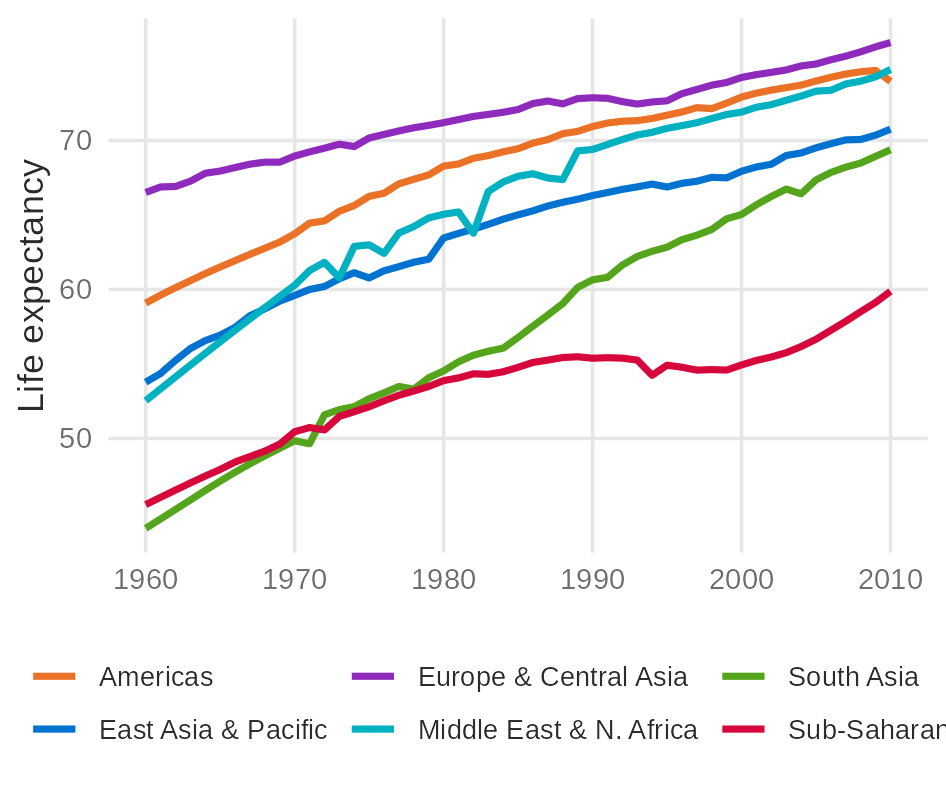
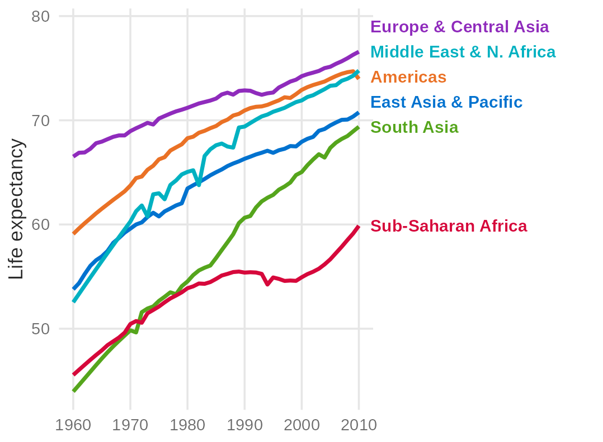

::: {.callout-tip}
#### Learning objectives

- Write headline titles, subtitles and captions.
- Replace legends with direct labels.
- Add annotations that explain the data.
- Remove clutter with themes, and build a reusable theme of your own.
:::

::: {.before-after}
<div><span class="chip before">Legend</span>



The eye goes line, legend, colour, line, for every line.</div>
<div><span class="chip after">Direct labels</span>



Each line is named where it ends.</div>
:::

## Load packages and data

::: {.panel-tabset group="language"}
## R

```{r}
library(tidyverse)

gapminder <- read_csv("data/gapminder_2010.csv")
gap_years <- read_csv("data/gapminder_1960_2010.csv")
```

## Python

```{python}
import pandas as pd
from plotnine import *

gapminder = pd.read_csv("data/gapminder_2010.csv")
gap_years = pd.read_csv("data/gapminder_1960_2010.csv")
```
:::

## Titles that say something <span class="badge-core">Core</span>

`labs()` sets the title, subtitle, caption and axis labels in one place.

- **Title**: the headline. What should the reader notice?
- **Subtitle**: what is measured, where and when.
- **Caption**: the source, and any notes on method.
- **Axis labels**: plain words with units, never raw variable names.

::: {.panel-tabset group="language"}
## R

```{r}
#| fig-height: 4.4
ggplot(gapminder, aes(x = children_per_woman, y = life_expectancy)) +
  geom_point(alpha = 0.6) +
  labs(title = "Where families are smaller, people live longer",
       subtitle = "167 countries, 2010",
       caption = "Source: Gapminder",
       x = "Children per woman",
       y = "Life expectancy (years)")
```

## Python

```{python}
p = (ggplot(gapminder, aes(x="children_per_woman", y="life_expectancy"))
     + geom_point(alpha=0.6)
     + labs(title="Where families are smaller, people live longer",
            subtitle="167 countries, 2010",
            caption="Source: Gapminder",
            x="Children per woman",
            y="Life expectancy (years)")
     + theme(figure_size=(7, 4.4)))
p.show()
```
:::

::: {.callout-note}
#### Titles in papers

Journals usually want the headline in the figure legend rather than on the figure. The principle is the same: the first sentence of the legend should state the message. For talks and posters, put the headline on the figure itself.
:::

## Direct labels instead of legends <span class="badge-core">Core</span>

For line charts, labelling each line where it ends removes the need for a legend. The approach is the same in both languages: make a small table of the last point of each line, then draw text there.

::: {.panel-tabset group="language"}
## R

```{r}
#| fig-height: 4.4
region_years <- gap_years |>
  group_by(region, year) |>
  summarise(life_expectancy = mean(life_expectancy, na.rm = TRUE), .groups = "drop")

line_ends <- region_years |> filter(year == max(year))

ggplot(region_years, aes(x = year, y = life_expectancy, colour = region)) +
  geom_line(linewidth = 1.1) +
  geom_text(data = line_ends, aes(label = region),
            hjust = 0, nudge_x = 1.5, size = 3.6, fontface = "bold") +
  scale_x_continuous(breaks = seq(1960, 2010, 10),
                     expand = expansion(mult = c(0.02, 0.45))) +
  labs(x = NULL, y = "Mean life expectancy (years)") +
  theme_minimal() +
  theme(legend.position = "none")
```

## Python

```{python}
region_years = (gap_years
                .groupby(["region", "year"], as_index=False)["life_expectancy"]
                .mean())
line_ends = region_years[region_years["year"] == region_years["year"].max()]

p = (ggplot(region_years, aes(x="year", y="life_expectancy", color="region"))
     + geom_line(size=1.1)
     + geom_text(line_ends, aes(label="region"),
                 ha="left", nudge_x=1.5, size=10, fontweight="bold")
     + scale_x_continuous(breaks=range(1960, 2011, 10), limits=(1960, 2035))
     + labs(x="", y="Mean life expectancy (years)")
     + theme_minimal()
     + theme(legend_position="none", figure_size=(7, 4.4)))
p.show()
```
:::

We extended the x axis to make room for the labels. Some labels may overlap where lines end close together. You can nudge individual labels by hand, or in R use the ggrepel package (`geom_text_repel()`), which moves labels apart automatically.

## Annotation <span class="badge-core">Core</span>

Annotations explain *why* the data looks the way it does. `annotate()` adds a single piece of text, a line or a shape at a position you choose.

::: {.panel-tabset group="language"}
## R

```{r}
#| fig-height: 3.8
rwanda <- gap_years |> filter(country == "Rwanda")

ggplot(rwanda, aes(x = year, y = life_expectancy)) +
  geom_line(linewidth = 1.1, colour = "#003E72") +
  annotate("segment", x = 1985, xend = 1993.5, y = 25, yend = 15,
           colour = "grey40", arrow = arrow(length = unit(2, "mm"))) +
  annotate("text", x = 1984, y = 26, label = "1994 genocide", hjust = 1, colour = "grey30") +
  labs(title = "Rwanda: life expectancy collapsed in 1994 and then recovered",
       x = NULL, y = "Life expectancy (years)") +
  theme_minimal()
```

## Python

```{python}
rwanda = gap_years[gap_years["country"] == "Rwanda"]

p = (ggplot(rwanda, aes(x="year", y="life_expectancy"))
     + geom_line(size=1.1, color="#003E72")
     + annotate("segment", x=1985, xend=1993.5, y=25, yend=15,
                color="#666666", arrow=arrow(length=0.08))
     + annotate("text", x=1984, y=26, label="1994 genocide", ha="right", color="#4D4D4D")
     + labs(title="Rwanda: life expectancy collapsed in 1994 and then recovered",
            x="", y="Life expectancy (years)")
     + theme_minimal()
     + theme(figure_size=(7, 3.8)))
p.show()
```
:::

## Themes and clutter <span class="badge-core">Core</span>

Everything that is not data (grid lines, borders, backgrounds) should earn its place. Built-in themes such as `theme_minimal()` and `theme_classic()` are a good start. `theme()` controls individual elements; `element_blank()` removes one.

::: {.panel-tabset group="language"}
## R

```{r}
#| fig-height: 3.6
region_le <- gapminder |>
  group_by(region) |>
  summarise(life_expectancy = mean(life_expectancy))

ggplot(region_le, aes(x = life_expectancy, y = fct_reorder(region, life_expectancy))) +
  geom_col(fill = "grey70") +
  theme_minimal(base_size = 13) +
  theme(panel.grid.major.y = element_blank(),
        panel.grid.minor = element_blank()) +
  labs(x = "Mean life expectancy (years)", y = NULL)
```

## Python

```{python}
region_le = gapminder.groupby("region", as_index=False)["life_expectancy"].mean()
order = region_le.sort_values("life_expectancy")["region"]
region_le["region"] = pd.Categorical(region_le["region"], categories=order)

p = (ggplot(region_le, aes(x="region", y="life_expectancy"))
     + geom_col(fill="#B3B3B3")
     + coord_flip()
     + theme_minimal(base_size=13)
     + theme(panel_grid_major_y=element_blank(),
             panel_grid_minor=element_blank(),
             figure_size=(7, 3.6))
     + labs(x="", y="Mean life expectancy (years)"))
p.show()
```
:::

With `coord_flip()` in Python, the grid lines we removed are the ones that run along the bars. Try changing `panel_grid_major_y` to `panel_grid_major_x` to see the difference.

## Worked example: the full makeover <span class="badge-core">Core</span>

Here are all the techniques from this part of the course in one figure: sort, grey, highlight, label directly, and write a headline.

::: {.panel-tabset group="language"}
## R

```{r}
#| fig-height: 3.8
region_le |>
  mutate(focus = region == "Sub-Saharan Africa") |>
  ggplot(aes(x = life_expectancy, y = fct_reorder(region, life_expectancy), fill = focus)) +
  geom_col(width = 0.7) +
  geom_text(aes(label = sprintf("%.1f", life_expectancy)),
            hjust = 1.2, colour = "white", fontface = "bold") +
  scale_fill_manual(values = c("grey65", "#D6083B"), guide = "none") +
  scale_x_continuous(expand = expansion(mult = c(0, 0.02))) +
  labs(title = "Sub-Saharan Africa trails every other region by over 10 years",
       subtitle = "Mean life expectancy at birth across countries, 2010",
       caption = "Source: Gapminder", x = NULL, y = NULL) +
  theme_minimal(base_size = 13) +
  theme(panel.grid = element_blank(), axis.text.x = element_blank(),
        plot.title.position = "plot")
```

## Python

```{python}
region_le["focus"] = region_le["region"] == "Sub-Saharan Africa"
region_le["label"] = region_le["life_expectancy"].map("{:.1f}".format)

p = (ggplot(region_le, aes(x="region", y="life_expectancy", fill="focus"))
     + geom_col(width=0.7)
     + geom_text(aes(label="label"), ha="right", nudge_y=-1,
                 color="white", fontweight="bold")
     + coord_flip()
     + scale_fill_manual(values=["#A6A6A6", "#D6083B"], guide=None)
     + scale_y_continuous(expand=(0, 0))
     + labs(title="Sub-Saharan Africa trails every other region by over 10 years",
            subtitle="Mean life expectancy at birth across countries, 2010",
            caption="Source: Gapminder", x="", y="")
     + theme_minimal(base_size=13)
     + theme(panel_grid=element_blank(), axis_text_x=element_blank(),
             plot_title=element_text(size=13, weight="bold"),
             figure_size=(7, 3.8)))
p.show()
```
:::

Because the values are written on the bars, the x axis is no longer needed, so we removed its text.

## Your own theme <span class="badge-ext">Extension</span>

If you make many figures, for a thesis or a paper, define your theme once and reuse it. Every figure will then look consistent.

::: {.panel-tabset group="language"}
## R

```{r}
#| eval: false
theme_mine <- function(base_size = 13) {
  theme_minimal(base_size = base_size) +
    theme(panel.grid.minor = element_blank(),
          plot.title = element_text(face = "bold"),
          plot.title.position = "plot",
          legend.position = "top")
}

# then add + theme_mine() to any plot, or set it for the whole session:
theme_set(theme_mine())
```

## Python

```{python}
#| eval: false
def theme_mine(base_size=13):
    return (theme_minimal(base_size=base_size)
            + theme(panel_grid_minor=element_blank(),
                    plot_title=element_text(weight="bold"),
                    legend_position="top"))

# then add + theme_mine() to any plot, or set it for the whole session:
theme_set(theme_mine())
```
:::

## Exercises

::: {.callout-exercise}
#### Write the labels



Take any plot from an earlier chapter and give it a headline title, a subtitle, a caption with the source, and axis labels in plain words with units.

::: {.callout-answer collapse="true"}
There is no single right answer. Check your title by asking: does it tell the reader what to notice, or only what is plotted? "Income and life expectancy" is a label. "Richer countries live longer, but the gains shrink at the top" is a headline.
:::
:::

::: {.callout-exercise}
#### Label the lines



Plot life expectancy over time for Brazil, India, Rwanda and the United Kingdom, with direct labels at the end of each line and no legend.

::: {.callout-answer collapse="true"}

::: {.panel-tabset group="language"}
## R

```{r}
#| fig-height: 3.8
four <- gap_years |> filter(country %in% c("Brazil", "India", "Rwanda", "United Kingdom"))
ends <- four |> filter(year == max(year))

ggplot(four, aes(x = year, y = life_expectancy, colour = country)) +
  geom_line(linewidth = 1.1) +
  geom_text(data = ends, aes(label = country), hjust = 0, nudge_x = 1, fontface = "bold") +
  scale_x_continuous(expand = expansion(mult = c(0.02, 0.25))) +
  labs(x = NULL, y = "Life expectancy (years)") +
  theme_minimal() +
  theme(legend.position = "none")
```

## Python

```{python}
four = gap_years[gap_years["country"].isin(["Brazil", "India", "Rwanda", "United Kingdom"])]
ends = four[four["year"] == four["year"].max()]

p = (ggplot(four, aes(x="year", y="life_expectancy", color="country"))
     + geom_line(size=1.1)
     + geom_text(ends, aes(label="country"), ha="left", nudge_x=1, fontweight="bold")
     + scale_x_continuous(limits=(1960, 2025))
     + labs(x="", y="Life expectancy (years)")
     + theme_minimal()
     + theme(legend_position="none", figure_size=(7, 3.8)))
p.show()
```
:::
:::
:::

::: {.callout-exercise}
#### Annotate an event <span class="badge-ext">Extension</span>



Find another country with a sharp change in life expectancy (try Cambodia or Haiti). Plot it, and add an annotation that explains the event.

::: {.callout-answer collapse="true"}
Cambodia shows a severe fall in the late 1970s, during the Khmer Rouge regime. Haiti shows a sharp fall in 2010, the year of the earthquake. Use `annotate("text", ...)` for the label and `annotate("segment", ...)` with an arrow to point at the event, as in the Rwanda example.
:::
:::

## Summary

::: {.callout-tip}
#### Key points

- The title is a headline; the subtitle says what is measured; the caption gives the source.
- Use plain-language axis labels with units.
- Direct labels are usually better than legends.
- Annotations explain why the data looks the way it does.
- Remove non-data elements that do not help, and reuse a theme for consistency.
:::
