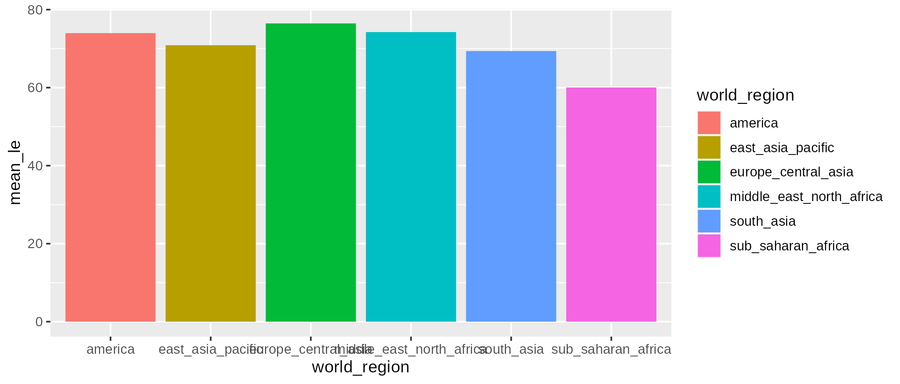
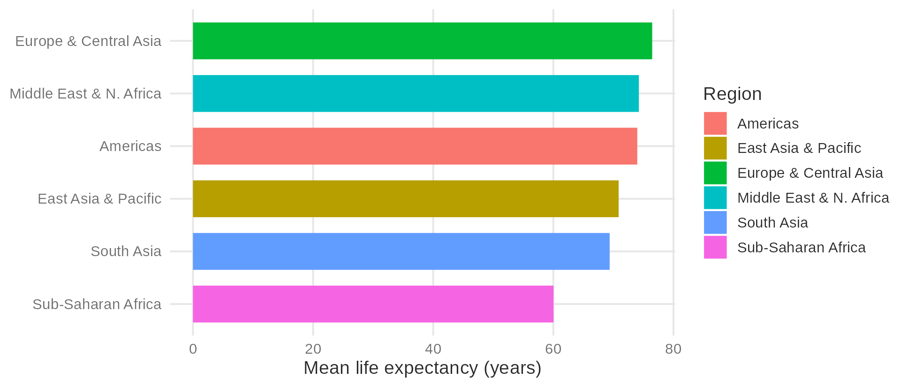
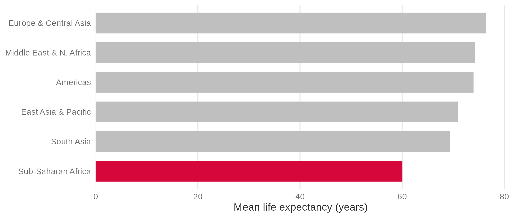
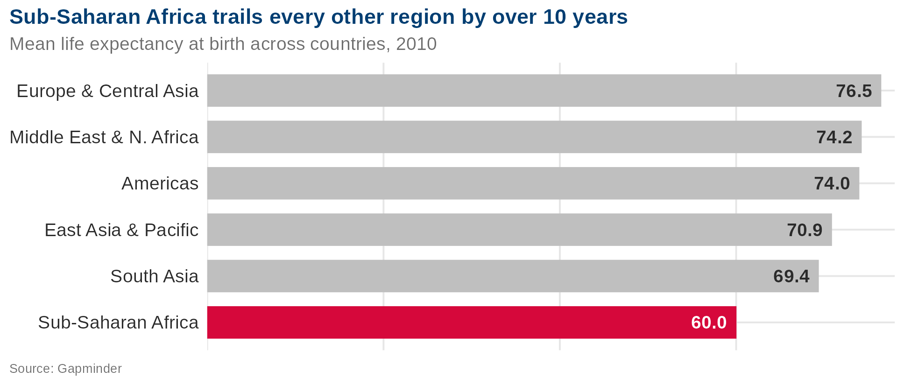

::: {.callout-tip}
#### Learning objectives

- Apply the whole design process to one figure, from headline to export.
- Give and receive feedback using the five questions.
- Explain the reasoning behind each design decision.
:::

## The challenge

Take one figure and make it better. You can use your own figure, a figure from the [critique gallery](../reference/gallery.qmd), or one of the briefs below. By the end you should have a *before* and an *after*, and be able to explain every change.

Plan for about 45 minutes, or longer if you are working on your own data.

## Step by step

::: {.process}
1. Headline&rarr;
2. Sketch&rarr;
3. Build&rarr;
4. Test&rarr;
5. Refine&rarr;
6. Export
:::

1. **Write the headline.** One sentence: what should the reader take away? Write it before any code.
2. **Sketch two versions** on paper. Which better supports the headline?
3. **Build** the best sketch. A good order of work is: chart type, then sorting, then grey and highlight, then labels, then the theme.
4. **Test** with someone else. Show it for five seconds, hide it, and ask what they remember. Then go through the [five questions](../reference/checklist.qmd) together.
5. **Refine** based on what they said.
6. **Export** at the final size, and check it at 100% zoom.

## Worked example

Here is the makeover sequence from the course, one step at a time. The code for the final version is in [Labels, titles and annotation](labels-and-annotation.qmd#worked-example-the-full-makeover).

**Headline:** *Sub-Saharan Africa trails every other region by over 10 years.*

::: {.panel-tabset}
## Before

## Step 1

## Step 2

## After

:::

## Briefs

If you do not have your own figure, choose one of these.

::: {.callout-exercise}
#### Brief 1: income and health



**Data:** `gapminder_2010.csv`

**Audience:** a general audience reading a news article.

**Task:** show that the relationship between income and life expectancy flattens out among richer countries. Highlight one region of your choice.
:::

::: {.callout-exercise}
#### Brief 2: three species



**Data:** `penguins.csv`

**Audience:** a conference talk to ecologists. The slide will be on screen for about 30 seconds.

**Task:** show how body mass differs between species and between sexes. Show the data, not just the means.
:::

::: {.callout-exercise}
#### Brief 3: fifty years of change



**Data:** `gapminder_1960_2010.csv`

**Audience:** readers of a journal article.

**Task:** show how child mortality changed between 1960 and 2010 in each region, and draw attention to one country whose story is different from its region's. Use small multiples, direct labels and at least one annotation. Export as a PDF at full page width.
:::

## Giving and receiving feedback

When you test your figure with someone:

- **Reviewer:** start by saying what you took away, before any suggestions. Be specific: "my eye went to the legend first" is more useful than "it's a bit busy". Offer options rather than instructions.
- **Owner:** listen and take notes. Resist the urge to explain. If the figure needs explaining, it needs changing.

## Reflect

When you have finished, write two or three sentences for yourself:

- What was the single change that helped most?
- What will you do differently next time you make a figure?

## Summary

::: {.callout-tip}
#### Key points

- Start with the headline, then sketch, build, test and refine.
- Work in a sensible order: chart type, sorting, colour, labels, theme.
- Test with a fresh pair of eyes and the five questions.
- Export at the final size and check at 100% zoom.
:::
