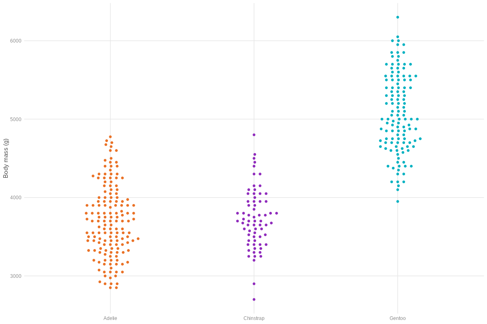
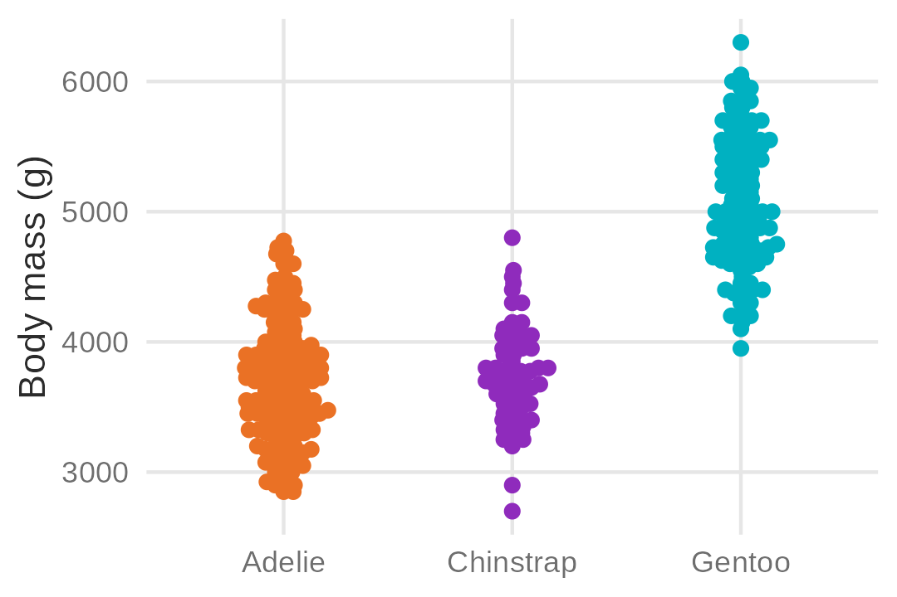
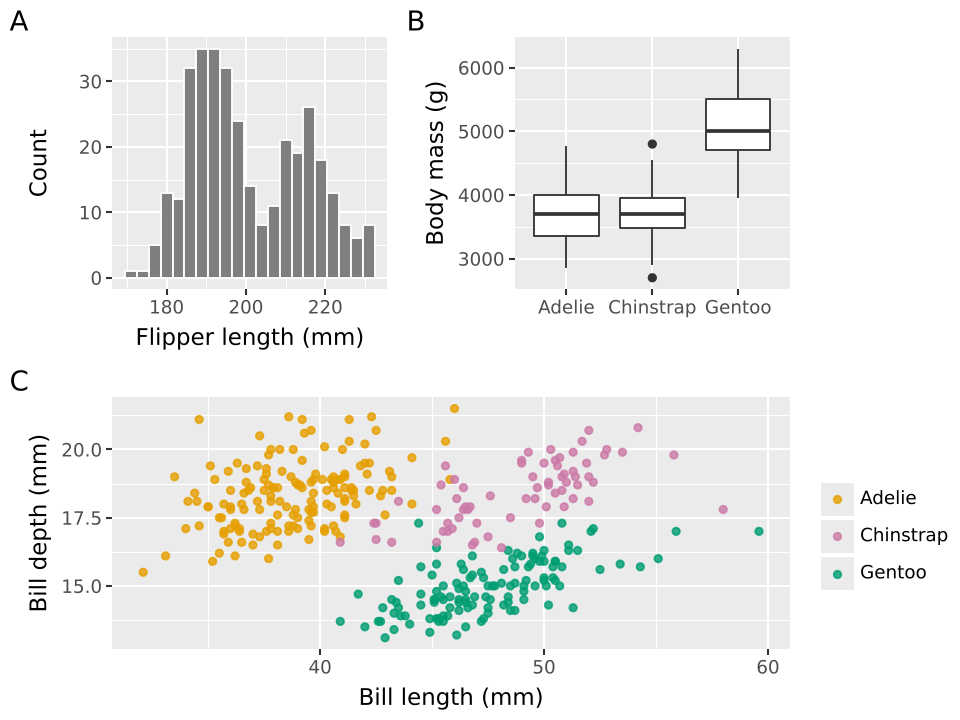
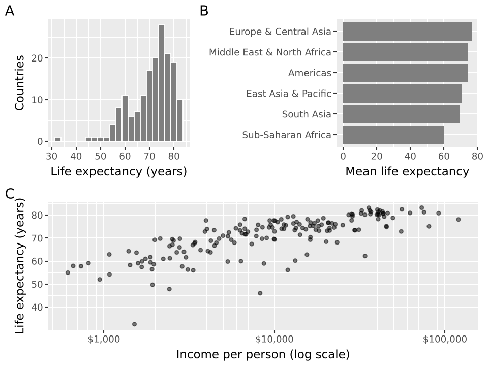

::: {.callout-tip}
#### Learning objectives

- Combine several plots into one figure with panel labels.
- Choose between small multiples and combined plots.
- Save figures at their final size, in a suitable format.
- Keep every figure reproducible from a script.
:::

::: {.before-after}
<div><span class="chip before">Made big, then shrunk</span>



Saved at screen size, then squeezed into a journal column.</div>
<div><span class="chip after">Made at final size</span>



Saved at the width it will be printed. Text stays readable.</div>
:::

## Load packages and data

::: {.panel-tabset group="language"}
## R

```{r}
library(tidyverse)
library(patchwork)

penguins <- read_csv("data/penguins.csv")
species_cols <- c(Adelie = "#E69F00", Chinstrap = "#CC79A7", Gentoo = "#009E73")
```

## Python

```{python}
import pandas as pd
from plotnine import *

penguins = pd.read_csv("data/penguins.csv")
species_cols = {"Adelie": "#E69F00", "Chinstrap": "#CC79A7", "Gentoo": "#009E73"}
```
:::

## Small multiples or combined plots? <span class="badge-core">Core</span>

There are two kinds of multi-panel figure:

- **Small multiples**: the *same* plot repeated for different subsets of the data, with shared axes. Use `facet_wrap()` or `facet_grid()`. You have met these in earlier chapters.
- **Combined plots**: *different* plots that together tell one story, such as a distribution, a comparison and a relationship. Use patchwork in R, or the composition operators in plotnine.

## Combining plots <span class="badge-core">Core</span>

Make each plot separately and store it in an object. Then combine them: `|` puts plots side by side and `/` stacks them.

::: {.panel-tabset group="language"}
## R

```{r}
#| fig-height: 5.5
p_hist <- ggplot(penguins, aes(x = flipper_length_mm)) +
  geom_histogram(binwidth = 3, fill = "grey50", colour = "white") +
  labs(x = "Flipper length (mm)", y = "Count")

p_box <- ggplot(penguins, aes(x = species, y = body_mass_g)) +
  geom_boxplot() +
  labs(x = NULL, y = "Body mass (g)")

p_scatter <- ggplot(penguins, aes(x = bill_length_mm, y = bill_depth_mm, colour = species)) +
  geom_point(alpha = 0.8) +
  scale_colour_manual(values = species_cols) +
  labs(x = "Bill length (mm)", y = "Bill depth (mm)", colour = NULL)

(p_hist | p_box) / p_scatter +
  plot_annotation(tag_levels = "A")
```

`plot_annotation(tag_levels = "A")` adds the panel letters automatically.

## Python

```{python}
#| eval: false
p_hist = (ggplot(penguins, aes(x="flipper_length_mm"))
          + geom_histogram(binwidth=3, fill="#7F7F7F", color="white")
          + labs(x="Flipper length (mm)", y="Count", tag="A"))

p_box = (ggplot(penguins, aes(x="species", y="body_mass_g"))
         + geom_boxplot()
         + labs(x="", y="Body mass (g)", tag="B"))

p_scatter = (ggplot(penguins, aes(x="bill_length_mm", y="bill_depth_mm", color="species"))
             + geom_point(alpha=0.8)
             + scale_color_manual(values=species_cols)
             + labs(x="Bill length (mm)", y="Bill depth (mm)", color="", tag="C"))

p = (p_hist | p_box) / p_scatter
p.show()
```

```{python}
#| echo: false
p_hist = (ggplot(penguins, aes(x="flipper_length_mm"))
          + geom_histogram(binwidth=3, fill="#7F7F7F", color="white")
          + labs(x="Flipper length (mm)", y="Count", tag="A"))

p_box = (ggplot(penguins, aes(x="species", y="body_mass_g"))
         + geom_boxplot()
         + labs(x="", y="Body mass (g)", tag="B"))

p_scatter = (ggplot(penguins, aes(x="bill_length_mm", y="bill_depth_mm", color="species"))
             + geom_point(alpha=0.8)
             + scale_color_manual(values=species_cols)
             + labs(x="Bill length (mm)", y="Bill depth (mm)", color="", tag="C"))

p = (p_hist | p_box) / p_scatter
p.save("images/generated/penguin-panels.png", width=7, height=5.5, dpi=150, verbose=False)
```




In plotnine, panel letters are added to each plot with `labs(tag=...)`.
:::

::: {.callout-important}
#### Design principle: one figure, one story

A multi-panel figure should still have a single message, with each panel contributing to it. If the panels tell unrelated stories, they are probably separate figures.
:::

## Saving at the final size <span class="badge-core">Core</span>

The most common reason for unreadable figures in papers is that they were made at one size and printed at another. Text, points and lines are drawn at a fixed physical size, so shrinking the image shrinks them too.

Decide the final width first, then save at exactly that size:

| Where it goes | Typical width |
|---|---|
| Single journal column | 8 to 9 cm |
| Full page width | 17 to 18 cm |
| Slide (16:9) | about 25 cm wide, 13 cm tall |
| A0 poster panel | depends on layout; check at 100% zoom |

::: {.panel-tabset group="language"}
## R

```{r}
#| eval: false
p <- ggplot(penguins, aes(x = species, y = body_mass_g)) +
  geom_boxplot() +
  labs(x = NULL, y = "Body mass (g)") +
  theme_minimal(base_size = 9)

ggsave("figures/body_mass.pdf", p, width = 8.5, height = 6, units = "cm")
ggsave("figures/body_mass.png", p, width = 8.5, height = 6, units = "cm", dpi = 600)
```

For a combined patchwork figure, save the combined object in exactly the same way.

## Python

```{python}
#| eval: false
p = (ggplot(penguins, aes(x="species", y="body_mass_g"))
     + geom_boxplot()
     + labs(x="", y="Body mass (g)")
     + theme_minimal(base_size=9))

p.save("figures/body_mass.pdf", width=8.5, height=6, units="cm")
p.save("figures/body_mass.png", width=8.5, height=6, units="cm", dpi=600)
```

Combined plots made with `|` and `/` have the same `save()` method.
:::

At a journal column width, a base font size of 8 to 10 points usually matches the text of the paper. For slides, use 16 or more.

## Which file format? <span class="badge-core">Core</span>

| Format | Type | Use for |
|---|---|---|
| **PDF** or **SVG** | Vector: shapes and text, sharp at any size | Papers, posters, theses; editing in Illustrator or Inkscape |
| **PNG** | Raster: pixels | Slides, web pages, documents; use 300 dpi or more for print |
| **TIFF** | Raster | Only when a journal requires it |
| JPEG | Raster, lossy | Photographs, not plots: it blurs lines and text |

When in doubt, save a PDF for print and a PNG for screens.

## Reproducible figures <span class="badge-core">Core</span>

- **Script every figure**, including panel letters, labels and annotations. Edits made by hand in other software have to be redone every time the data changes.
- **Define colours and themes once**, at the top of your script or in a shared file, so every figure in a paper or thesis is consistent.
- **Save with explicit sizes**, never by copying from the screen.
- **Keep the script with the data** it uses, ideally in a version-controlled project.

## Exercises

::: {.callout-exercise}
#### A three-panel figure



Using the Gapminder 2010 data, make a figure with three panels labelled A to C: a histogram of life expectancy, a sorted bar chart of mean life expectancy by region, and a scatter plot of income against life expectancy. Save it at full page width (17 cm) as a PDF.

::: {.callout-answer collapse="true"}

::: {.panel-tabset group="language"}
## R

```{r}
#| fig-height: 5.5
gapminder <- read_csv("data/gapminder_2010.csv")

a <- ggplot(gapminder, aes(x = life_expectancy)) +
  geom_histogram(binwidth = 2.5, fill = "grey50", colour = "white") +
  labs(x = "Life expectancy (years)", y = "Countries")

b <- gapminder |>
  group_by(region) |>
  summarise(le = mean(life_expectancy)) |>
  ggplot(aes(x = le, y = fct_reorder(region, le))) +
  geom_col(fill = "grey50") +
  labs(x = "Mean life expectancy", y = NULL)

c <- ggplot(gapminder, aes(x = income_per_person, y = life_expectancy)) +
  geom_point(alpha = 0.5) +
  scale_x_log10(labels = scales::label_dollar(accuracy = 1)) +
  labs(x = "Income per person (log scale)", y = "Life expectancy (years)")

fig <- (a | b) / c + plot_annotation(tag_levels = "A")
fig
```

```{r}
#| eval: false
ggsave("figures/gapminder_overview.pdf", fig, width = 17, height = 13, units = "cm")
```

## Python

```{python}
#| eval: false
gapminder = pd.read_csv("data/gapminder_2010.csv")

a = (ggplot(gapminder, aes(x="life_expectancy"))
     + geom_histogram(binwidth=2.5, fill="#7F7F7F", color="white")
     + labs(x="Life expectancy (years)", y="Countries", tag="A"))

region_le = gapminder.groupby("region", as_index=False)["life_expectancy"].mean()
order = region_le.sort_values("life_expectancy")["region"]
region_le["region"] = pd.Categorical(region_le["region"], categories=order)

b = (ggplot(region_le, aes(x="region", y="life_expectancy"))
     + geom_col(fill="#7F7F7F")
     + coord_flip()
     + labs(x="", y="Mean life expectancy", tag="B"))

c = (ggplot(gapminder, aes(x="income_per_person", y="life_expectancy"))
     + geom_point(alpha=0.5)
     + scale_x_log10(labels=lambda breaks: [f"${b:,.0f}" for b in breaks])
     + labs(x="Income per person (log scale)", y="Life expectancy (years)", tag="C"))

p = (a | b) / c
p.show()
```

```{python}
#| echo: false
gapminder = pd.read_csv("data/gapminder_2010.csv")

a = (ggplot(gapminder, aes(x="life_expectancy"))
     + geom_histogram(binwidth=2.5, fill="#7F7F7F", color="white")
     + labs(x="Life expectancy (years)", y="Countries", tag="A"))

region_le = gapminder.groupby("region", as_index=False)["life_expectancy"].mean()
order = region_le.sort_values("life_expectancy")["region"]
region_le["region"] = pd.Categorical(region_le["region"], categories=order)

b = (ggplot(region_le, aes(x="region", y="life_expectancy"))
     + geom_col(fill="#7F7F7F")
     + coord_flip()
     + labs(x="", y="Mean life expectancy", tag="B"))

c = (ggplot(gapminder, aes(x="income_per_person", y="life_expectancy"))
     + geom_point(alpha=0.5)
     + scale_x_log10(labels=lambda breaks: [f"${b:,.0f}" for b in breaks])
     + labs(x="Income per person (log scale)", y="Life expectancy (years)", tag="C"))

p = (a | b) / c
p.save("images/generated/gapminder-panels.png", width=7, height=5.5, dpi=150, verbose=False)
```




```{python}
#| eval: false
p.save("figures/gapminder_overview.pdf", width=17, height=13, units="cm")
```
:::
:::
:::

::: {.callout-exercise}
#### Check at final size <span class="badge-ext">Extension</span>



Open the PDF you saved and view it at 100% zoom, or print it. Is every label readable? If not, increase `base_size` in your theme, rather than making the figure bigger.

::: {.callout-answer collapse="true"}
Viewing at 100% is the only reliable check. If the text is too small, increase the base font size of the theme (for example `theme_minimal(base_size = 10)`) and save again at the same width.
:::
:::

## Summary

::: {.callout-tip}
#### Key points

- Use facets for small multiples, and patchwork or plotnine composition for combined plots.
- Add panel letters in code, not by hand.
- Decide the final size first, and save at exactly that size.
- Use vector formats (PDF, SVG) for print and PNG for screens.
- Script everything, so figures can be remade when the data changes.
:::
