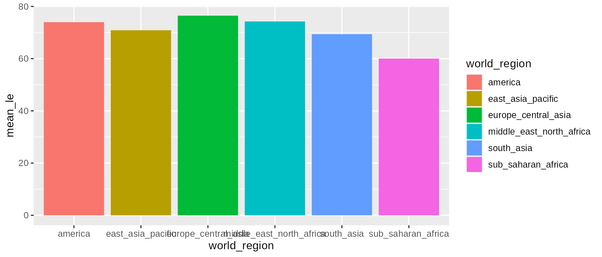
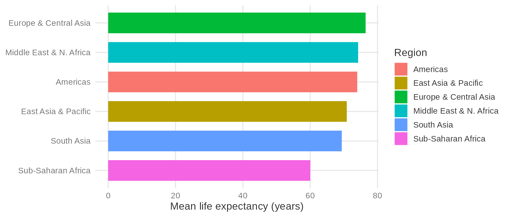

::: {.callout-tip}
#### Learning objectives

- Make bar charts of counts and of values.
- Sort categories so the order carries meaning.
- Use horizontal bars, dot plots and lollipops for long category names.
- Show parts of a whole without a pie chart.
:::

::: {.before-after}
<div><span class="chip before">Alphabetical</span>



Default order, raw labels, colour that adds nothing.</div>
<div><span class="chip after">Ranked</span>



Sorted, horizontal and readable. The order is now part of the message.</div>
:::

## Load packages and data

::: {.panel-tabset group="language"}
## R

```{r}
library(tidyverse)

gapminder <- read_csv("data/gapminder_2010.csv")
penguins <- read_csv("data/penguins.csv")
```

## Python

```{python}
import pandas as pd
from plotnine import *

gapminder = pd.read_csv("data/gapminder_2010.csv")
penguins = pd.read_csv("data/penguins.csv")
```
:::

## Counts and values <span class="badge-core">Core</span>

There are two kinds of bar chart:

- `geom_bar()` **counts rows** for you. Use it when each row is one observation.
- `geom_col()` **draws a value you already have**. Use it when you have calculated a number per category.

::: {.panel-tabset group="language"}
## R

```{r}
#| fig-height: 3.5
ggplot(penguins, aes(x = island)) +
  geom_bar() +
  labs(x = NULL, y = "Number of penguins")
```

## Python

```{python}
p = (ggplot(penguins, aes(x="island"))
     + geom_bar()
     + labs(x="", y="Number of penguins")
     + theme(figure_size=(7, 3.5)))
p.show()
```
:::

Now some values per category: mean life expectancy in each region.

::: {.panel-tabset group="language"}
## R

```{r}
region_le <- gapminder |>
  group_by(region) |>
  summarise(life_expectancy = mean(life_expectancy))

region_le
```

## Python

```{python}
region_le = (gapminder
             .groupby("region", as_index=False)["life_expectancy"]
             .mean())
region_le
```
:::

## Sort by value <span class="badge-core">Core</span>

By default, categories appear in alphabetical order, which is almost never what the reader needs. Sorting by value turns a lookup table into a ranking.

::: {.panel-tabset group="language"}
## R

In R, `fct_reorder()` reorders a categorical variable by another variable.

```{r}
#| fig-height: 3.5
ggplot(region_le, aes(x = life_expectancy, y = fct_reorder(region, life_expectancy))) +
  geom_col() +
  labs(x = "Mean life expectancy (years)", y = NULL)
```

Putting the categories on the y axis gives horizontal bars, so long names have room.

## Python

In Python, set the order by turning the column into an ordered category. plotnine draws horizontal bars with `coord_flip()`.

```{python}
order = region_le.sort_values("life_expectancy")["region"]
region_le["region"] = pd.Categorical(region_le["region"], categories=order)

p = (ggplot(region_le, aes(x="region", y="life_expectancy"))
     + geom_col()
     + coord_flip()
     + labs(x="", y="Mean life expectancy (years)")
     + theme(figure_size=(7, 3.5)))
p.show()
```

Note that with `coord_flip()` the `x` and `y` labels refer to the original axes, before flipping.
:::

::: {.callout-important}
#### Design principle: order is information

Sort by the value unless the categories have a natural order of their own, such as age groups, months, or dose levels. Then keep the natural order.
:::

## Dot plots and lollipops <span class="badge-core">Core</span>

Bars must start at zero, because we read their length. When all values are far from zero, or there are many categories, a dot plot uses less ink and lets the axis focus on the range that matters.

::: {.panel-tabset group="language"}
## R

```{r}
#| fig-height: 3.5
ggplot(region_le, aes(x = life_expectancy, y = fct_reorder(region, life_expectancy))) +
  geom_segment(aes(x = 55, xend = life_expectancy, yend = region), colour = "grey70") +
  geom_point(size = 4, colour = "#003E72") +
  labs(x = "Mean life expectancy (years)", y = NULL)
```

## Python

```{python}
p = (ggplot(region_le, aes(x="region", y="life_expectancy"))
     + geom_segment(aes(xend="region", y=55, yend="life_expectancy"), color="#B3B3B3")
     + geom_point(size=4, color="#003E72")
     + coord_flip()
     + labs(x="", y="Mean life expectancy (years)")
     + theme(figure_size=(7, 3.5)))
p.show()
```
:::

This is a *lollipop* chart: a dot plot with a thin line to guide the eye. Because the stick starts at 55 rather than 0, the length of the stick means nothing on its own. That is fine for dots and lollipops, but not for bars.

## Top and bottom <span class="badge-ext">Extension</span>

With many categories, show only the ones that matter for the message, and say so in the title.

::: {.panel-tabset group="language"}
## R

```{r}
#| fig-height: 3.8
gapminder |>
  slice_max(child_mortality, n = 10) |>
  ggplot(aes(x = child_mortality, y = fct_reorder(country, child_mortality))) +
  geom_col(fill = "#D6083B") +
  labs(title = "The ten countries with the highest child mortality in 2010",
       x = "Deaths before age 5 per 1,000 births", y = NULL)
```

## Python

```{python}
top10 = gapminder.nlargest(10, "child_mortality").copy()
order = top10.sort_values("child_mortality")["country"]
top10["country"] = pd.Categorical(top10["country"], categories=order)

p = (ggplot(top10, aes(x="country", y="child_mortality"))
     + geom_col(fill="#D6083B")
     + coord_flip()
     + labs(title="The ten countries with the highest child mortality in 2010",
            x="", y="Deaths before age 5 per 1,000 births")
     + theme(figure_size=(7, 3.8)))
p.show()
```
:::

## Parts of a whole <span class="badge-ext">Extension</span>

Pie charts encode values as angles and areas, which we compare poorly. For shares, a single stacked bar or a set of sorted bars is usually clearer. Here is the share of countries in each income group, by region.

::: {.panel-tabset group="language"}
## R

```{r}
#| fig-height: 3.8
gapminder |>
  mutate(income_groups = fct_relevel(income_groups, "low_income", "lower_middle_income",
                                     "upper_middle_income", "high_income")) |>
  ggplot(aes(y = region, fill = income_groups)) +
  geom_bar(position = "fill") +
  scale_x_continuous(labels = scales::label_percent()) +
  scale_fill_brewer(palette = "Blues",
                    labels = c("Low", "Lower middle", "Upper middle", "High")) +
  labs(x = "Share of countries", y = NULL, fill = "Income group")
```

## Python

```{python}
levels = ["low_income", "lower_middle_income", "upper_middle_income", "high_income"]
gapminder["income_groups"] = pd.Categorical(gapminder["income_groups"], categories=levels)

p = (ggplot(gapminder, aes(x="region", fill="income_groups"))
     + geom_bar(position="fill")
     + coord_flip()
     + scale_y_continuous(labels=lambda breaks: [f"{b:.0%}" for b in breaks])
     + scale_fill_brewer(palette="Blues",
                         labels=["Low", "Lower middle", "Upper middle", "High"])
     + labs(x="", y="Share of countries", fill="Income group")
     + theme(figure_size=(7, 3.8)))
p.show()
```
:::

Income groups have a natural order, so we set it explicitly and used a *sequential* palette (light to dark) to match. See [Colour with purpose](colour.qmd).

## Exercises

::: {.callout-exercise}
#### Ranked income



Make a horizontal bar chart of median income per person by region, sorted from highest to lowest.

::: {.callout-answer collapse="true"}

::: {.panel-tabset group="language"}
## R

```{r}
#| fig-height: 3.5
gapminder |>
  group_by(region) |>
  summarise(income = median(income_per_person)) |>
  ggplot(aes(x = income, y = fct_reorder(region, income))) +
  geom_col(fill = "#0072CF") +
  scale_x_continuous(labels = scales::label_dollar(accuracy = 1)) +
  labs(x = "Median income per person", y = NULL)
```

## Python

```{python}
income = gapminder.groupby("region", as_index=False)["income_per_person"].median()
order = income.sort_values("income_per_person")["region"]
income["region"] = pd.Categorical(income["region"], categories=order)

p = (ggplot(income, aes(x="region", y="income_per_person"))
     + geom_col(fill="#0072CF")
     + coord_flip()
     + scale_y_continuous(labels=lambda breaks: [f"${b:,.0f}" for b in breaks])
     + labs(x="", y="Median income per person")
     + theme(figure_size=(7, 3.5)))
p.show()
```
:::

In R, sorting with `fct_reorder()` puts the largest value at the top of a horizontal bar chart, because the y axis counts upwards from the bottom.
:::
:::

::: {.callout-exercise}
#### Bars or dots?



Make a dot plot of mean bill length per penguin species. Then make it as a bar chart. Which works better, and why?

::: {.callout-answer collapse="true"}

::: {.panel-tabset group="language"}
## R

```{r}
#| fig-height: 3
penguins |>
  group_by(species) |>
  summarise(bill = mean(bill_length_mm, na.rm = TRUE)) |>
  ggplot(aes(x = bill, y = fct_reorder(species, bill))) +
  geom_point(size = 4) +
  labs(x = "Mean bill length (mm)", y = NULL)
```

## Python

```{python}
bill = penguins.groupby("species", as_index=False)["bill_length_mm"].mean()
order = bill.sort_values("bill_length_mm")["species"]
bill["species"] = pd.Categorical(bill["species"], categories=order)

p = (ggplot(bill, aes(x="species", y="bill_length_mm"))
     + geom_point(size=4)
     + coord_flip()
     + labs(x="", y="Mean bill length (mm)")
     + theme(figure_size=(7, 3)))
p.show()
```
:::

All three means are between 38 and 49 mm. As bars starting from zero, the bars look almost the same length. As dots, the axis can zoom to the range of the data and the differences are clear. Better still would be to show the full distribution, as in [Distributions](distributions.qmd).
:::
:::

## Summary

::: {.callout-tip}
#### Key points

- `geom_bar()` counts rows; `geom_col()` draws values you have calculated.
- Sort categories by value unless they have a natural order.
- Horizontal bars give long labels room.
- Bars start at zero; dot plots and lollipops do not need to.
- Prefer sorted or stacked bars to pie charts for comparing shares.
:::
