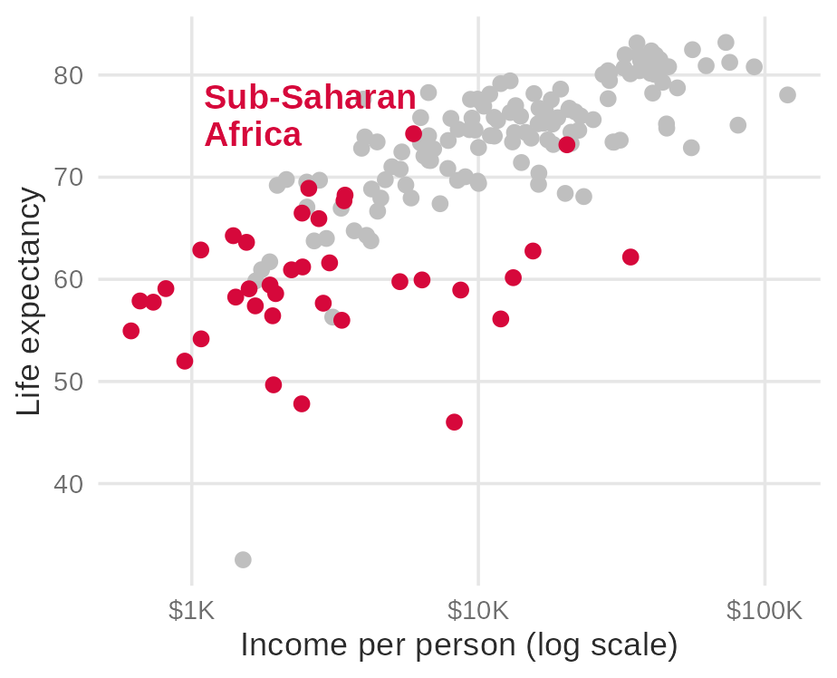

::: {.callout-tip}
#### Learning objectives

- Use scatter plots to explore the relationship between two numeric variables.
- Deal with skewed variables and overplotting.
- Add trend lines, and use a third variable without overloading the plot.
:::

::: {.hero}
{width=60%}
:::

## Load packages and data

We use the Gapminder data for 2010: one row per country.

::: {.panel-tabset group="language"}
## R

```{r}
library(tidyverse)

gapminder <- read_csv("data/gapminder_2010.csv")
```

## Python

```{python}
import pandas as pd
from plotnine import *

gapminder = pd.read_csv("data/gapminder_2010.csv")
```
:::

## The scatter plot <span class="badge-core">Core</span>

A scatter plot puts one variable on each axis and draws one point per observation. It is the default choice when you ask "does one thing go with another?"

::: {.panel-tabset group="language"}
## R

```{r}
ggplot(gapminder, aes(x = income_per_person, y = life_expectancy)) +
  geom_point()
```

## Python

```{python}
p = (ggplot(gapminder, aes(x="income_per_person", y="life_expectancy"))
     + geom_point())
p.show()
```
:::

Most countries are squashed into the left of the plot, because a few very rich countries stretch the x axis. Income is a classic *skewed* variable.

## Log scales for skewed data <span class="badge-core">Core</span>

On a log scale, each step along the axis is a multiplication rather than an addition: 1,000 to 10,000 to 100,000. This spreads out the crowded low values.

::: {.panel-tabset group="language"}
## R

```{r}
ggplot(gapminder, aes(x = income_per_person, y = life_expectancy)) +
  geom_point() +
  scale_x_log10(labels = scales::label_dollar(accuracy = 1)) +
  labs(x = "Income per person (log scale)", y = "Life expectancy (years)")
```

## Python

```{python}
p = (ggplot(gapminder, aes(x="income_per_person", y="life_expectancy"))
     + geom_point()
     + scale_x_log10(labels=lambda breaks: [f"${b:,.0f}" for b in breaks])
     + labs(x="Income per person (log scale)", y="Life expectancy (years)"))
p.show()
```
:::

The relationship now looks close to a straight line: each doubling of income is associated with a similar gain in life expectancy.

::: {.callout-important}
#### Design principle: say when an axis is on a log scale

Many readers assume a linear axis. Write "log scale" in the axis label, and use readable tick labels such as $1,000 rather than 3.
:::

## Overplotting <span class="badge-core">Core</span>

When points overlap, dense areas look the same as sparse ones. Transparency (`alpha`) helps: overlapping points build up darker areas.

::: {.panel-tabset group="language"}
## R

```{r}
ggplot(gapminder, aes(x = income_per_person, y = life_expectancy)) +
  geom_point(size = 2.5, alpha = 0.4, colour = "#003E72") +
  scale_x_log10(labels = scales::label_dollar(accuracy = 1)) +
  labs(x = "Income per person (log scale)", y = "Life expectancy (years)")
```

## Python

```{python}
p = (ggplot(gapminder, aes(x="income_per_person", y="life_expectancy"))
     + geom_point(size=2.5, alpha=0.4, color="#003E72")
     + scale_x_log10(labels=lambda breaks: [f"${b:,.0f}" for b in breaks])
     + labs(x="Income per person (log scale)", y="Life expectancy (years)"))
p.show()
```
:::

With thousands of points, consider `geom_bin_2d()` or `geom_hex()`, which count points in small tiles, or a density contour.

## Trend lines <span class="badge-core">Core</span>

`geom_smooth()` adds a fitted line. `method = "lm"` fits a straight line; the default in R is a flexible curve (loess), which is useful for spotting non-linear patterns. The grey band is a confidence interval for the fitted line.

::: {.panel-tabset group="language"}
## R

```{r}
ggplot(gapminder, aes(x = income_per_person, y = life_expectancy)) +
  geom_point(alpha = 0.4) +
  geom_smooth(method = "lm", colour = "#D6083B") +
  scale_x_log10(labels = scales::label_dollar(accuracy = 1)) +
  labs(x = "Income per person (log scale)", y = "Life expectancy (years)")
```

## Python

```{python}
p = (ggplot(gapminder, aes(x="income_per_person", y="life_expectancy"))
     + geom_point(alpha=0.4)
     + geom_smooth(method="lm", color="#D6083B")
     + scale_x_log10(labels=lambda breaks: [f"${b:,.0f}" for b in breaks])
     + labs(x="Income per person (log scale)", y="Life expectancy (years)"))
p.show()
```
:::

A trend line is a model. Only add one if it helps the message, and say what kind of line it is in the legend or caption. This course is about showing relationships; to calculate and test them, see [Core statistics 3: correlations](https://cambiotraining.github.io/corestats/materials/cs3_practical_correlations.html).

## Adding a third variable <span class="badge-core">Core</span>

Colour is the most common way to add a grouping variable. With six regions, though, the plot quickly becomes hard to read: six colours to tell apart and a legend to decode.

::: {.panel-tabset group="language"}
## R

```{r}
ggplot(gapminder, aes(x = income_per_person, y = life_expectancy, colour = region)) +
  geom_point(size = 2) +
  scale_x_log10(labels = scales::label_dollar(accuracy = 1)) +
  labs(x = "Income per person (log scale)", y = "Life expectancy (years)", colour = NULL)
```

## Python

```{python}
p = (ggplot(gapminder, aes(x="income_per_person", y="life_expectancy", color="region"))
     + geom_point(size=2)
     + scale_x_log10(labels=lambda breaks: [f"${b:,.0f}" for b in breaks])
     + labs(x="Income per person (log scale)", y="Life expectancy (years)", color=""))
p.show()
```
:::

Two better options, depending on the message:

1. **Highlight one group** and make the rest grey. This is covered in [Colour with purpose](colour.qmd).
2. **Split into small multiples**, one panel per group, using `facet_wrap()`.

::: {.panel-tabset group="language"}
## R

```{r}
#| fig-height: 5
ggplot(gapminder, aes(x = income_per_person, y = life_expectancy)) +
  geom_point(data = select(gapminder, -region), colour = "grey85", size = 1.2) +
  geom_point(colour = "#0072CF", size = 1.5) +
  facet_wrap(~ region) +
  scale_x_log10(labels = scales::label_dollar(accuracy = 1)) +
  labs(x = "Income per person (log scale)", y = "Life expectancy (years)")
```

## Python

```{python}
background = gapminder.drop(columns="region")

p = (ggplot(gapminder, aes(x="income_per_person", y="life_expectancy"))
     + geom_point(data=background, color="#D9D9D9", size=1.2)
     + geom_point(color="#0072CF", size=1.5)
     + facet_wrap("region")
     + scale_x_log10(labels=lambda breaks: [f"${b:,.0f}" for b in breaks])
     + labs(x="Income per person (log scale)", y="Life expectancy (years)")
     + theme(figure_size=(7, 5)))
p.show()
```
:::

The trick here is the first layer. It uses a copy of the data with the region column removed, so `facet_wrap()` cannot split it, and every panel shows *all* the countries in light grey. Each region is then drawn on top in blue, compared against the whole world.

## Exercises

::: {.callout-exercise}
#### Children and child mortality



Plot the number of children per woman (x) against child mortality (y). Is a log scale useful for either axis? Add a sensible title.

::: {.callout-answer collapse="true"}

::: {.panel-tabset group="language"}
## R

```{r}
ggplot(gapminder, aes(x = children_per_woman, y = child_mortality)) +
  geom_point(alpha = 0.6) +
  scale_y_log10() +
  labs(title = "Where women have more children, more children die young",
       x = "Children per woman", y = "Child deaths per 1,000 births (log scale)")
```

## Python

```{python}
p = (ggplot(gapminder, aes(x="children_per_woman", y="child_mortality"))
     + geom_point(alpha=0.6)
     + scale_y_log10()
     + labs(title="Where women have more children, more children die young",
            x="Children per woman", y="Child deaths per 1,000 births (log scale)"))
p.show()
```
:::

Child mortality is skewed, so a log scale on y spreads out the low values. Children per woman is not strongly skewed, so a linear axis is fine. Be careful with the headline: this is a correlation across countries, not evidence that one causes the other.
:::
:::

::: {.callout-exercise}
#### Size as a channel



Map `population` to point size in the income and life expectancy plot. What does it add? What problems does it introduce?

::: {.callout-answer collapse="true"}

::: {.panel-tabset group="language"}
## R

```{r}
ggplot(gapminder, aes(x = income_per_person, y = life_expectancy, size = population)) +
  geom_point(alpha = 0.5, colour = "#003E72") +
  scale_x_log10(labels = scales::label_dollar(accuracy = 1)) +
  scale_size_area(max_size = 15, guide = "none") +
  labs(x = "Income per person (log scale)", y = "Life expectancy (years)")
```

## Python

```{python}
p = (ggplot(gapminder, aes(x="income_per_person", y="life_expectancy", size="population"))
     + geom_point(alpha=0.5, color="#003E72")
     + scale_x_log10(labels=lambda breaks: [f"${b:,.0f}" for b in breaks])
     + scale_size_area(max_size=15)
     + guides(size=None)
     + labs(x="Income per person (log scale)", y="Life expectancy (years)"))
p.show()
```
:::

Size shows which countries affect the most people. But area is a channel we read inaccurately, large bubbles hide small ones, and you need a legend to decode it. Use it for a rough impression, not for precise comparisons. `scale_size_area()` makes the bubble area, rather than its radius, proportional to the value, which is the honest choice.
:::
:::

## Summary

::: {.callout-tip}
#### Key points

- Scatter plots are the default for relationships between two numeric variables.
- Use a log scale for skewed variables, and label it clearly.
- Transparency reduces overplotting.
- A trend line is a model: add it only when it supports the message.
- With many groups, highlight one or use small multiples instead of many colours.
:::
