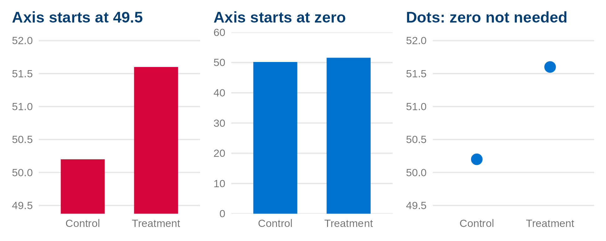
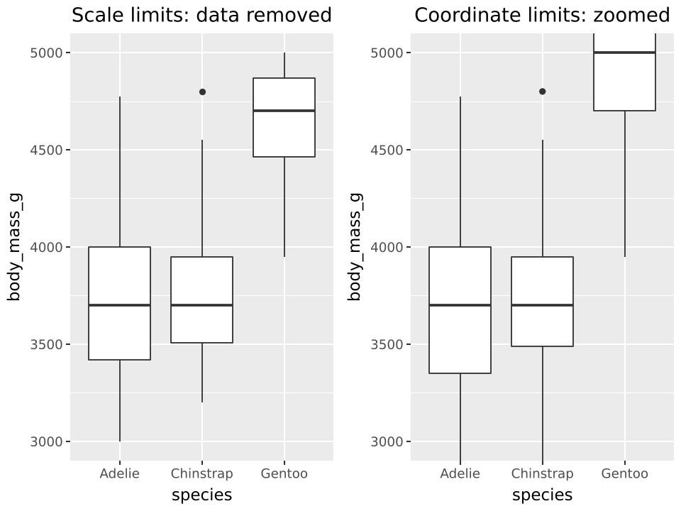
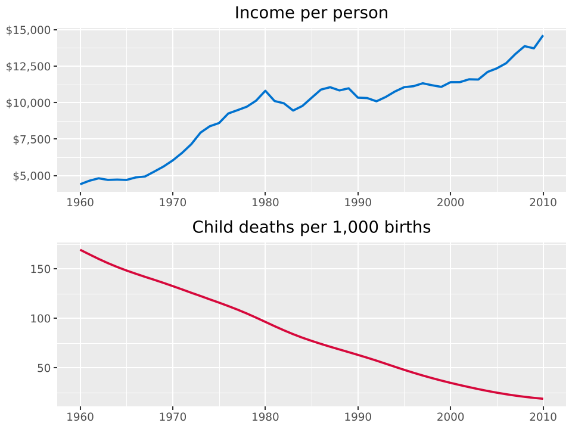
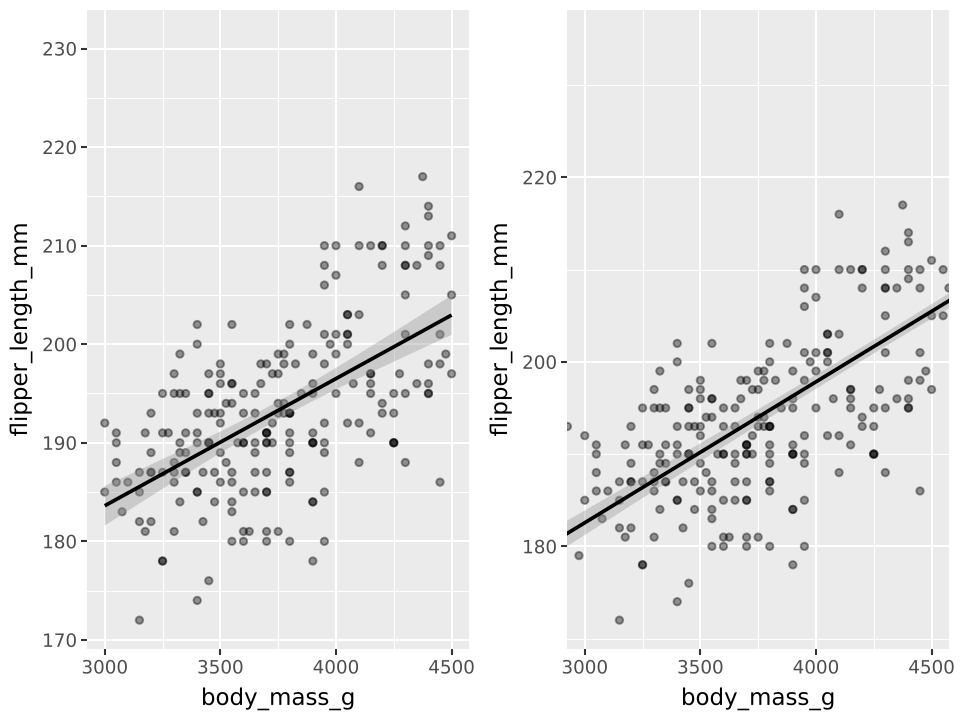

::: {.callout-tip}
#### Learning objectives

- Decide when an axis must start at zero.
- Zoom into data without accidentally removing it.
- Format axis breaks and labels for readers.
- Recognise misleading choices such as dual axes and distorted aspect ratios.
:::

::: {.hero}

:::

## Load packages and data

::: {.panel-tabset group="language"}
## R

```{r}
library(tidyverse)
library(patchwork)

gapminder <- read_csv("data/gapminder_2010.csv")
gap_years <- read_csv("data/gapminder_1960_2010.csv")
penguins <- read_csv("data/penguins.csv")
```

## Python

```{python}
import pandas as pd
from plotnine import *

gapminder = pd.read_csv("data/gapminder_2010.csv")
gap_years = pd.read_csv("data/gapminder_1960_2010.csv")
penguins = pd.read_csv("data/penguins.csv")
```
:::

We also load **patchwork** in R, which puts plots side by side with `|` and on top of each other with `/`. In Python, plotnine has the same operators built in. We cover this properly in [Multi-panel figures and export](multi-panel-and-export.qmd).

## When must an axis start at zero? <span class="badge-core">Core</span>

It depends on the channel the reader uses.

- **Bars and areas** are read by their *length*. A bar twice as long looks like twice the amount. If the axis does not start at zero, the lengths lie. **Bars always start at zero.**
- **Points and lines** are read by their *position*. The axis can focus on the range where the data is, as long as it is clearly labelled.

In the figure above, the left panel makes a 3% difference look like a fivefold one. The middle panel is honest but makes the difference hard to see. The right panel uses dots, so it can zoom in honestly.

ggplot2 and plotnine start bar axes at zero by default. The danger usually comes from zooming in afterwards.

## Zooming without losing data <span class="badge-core">Core</span>

There are two ways to change the range of an axis, and they behave very differently.

- **Scale limits** (`scale_y_continuous(limits = ...)` or `ylim()`) *remove* data outside the range before anything is calculated. Box plots, means and trend lines change.
- **Coordinate limits** (`coord_cartesian(ylim = ...)`) *zoom* the view, like a camera. All the data is still used.

::: {.panel-tabset group="language"}
## R

```{r}
#| fig-height: 3.5
base <- ggplot(penguins, aes(x = species, y = body_mass_g)) + geom_boxplot()

removed <- base + scale_y_continuous(limits = c(3000, 5000)) + ggtitle("Scale limits: data removed")
zoomed <- base + coord_cartesian(ylim = c(3000, 5000)) + ggtitle("Coordinate limits: zoomed")

removed | zoomed
```

## Python

```{python}
#| eval: false
base = ggplot(penguins, aes(x="species", y="body_mass_g")) + geom_boxplot()

removed = base + scale_y_continuous(limits=(3000, 5000)) + ggtitle("Scale limits: data removed")
zoomed = base + coord_cartesian(ylim=(3000, 5000)) + ggtitle("Coordinate limits: zoomed")

p = removed | zoomed
p.show()
```

```{python}
#| echo: false
base = ggplot(penguins, aes(x="species", y="body_mass_g")) + geom_boxplot()

removed = base + scale_y_continuous(limits=(3000, 5000)) + ggtitle("Scale limits: data removed")
zoomed = base + coord_cartesian(ylim=(3000, 5000)) + ggtitle("Coordinate limits: zoomed")

p = removed | zoomed
p.save("images/generated/zoom-limits.png", width=7, height=3.5, dpi=150, verbose=False)
```



:::

Look at the Gentoo box. On the left, every penguin heavier than 5,000 g was thrown away before the box was drawn, so the median is wrong. On the right, the box is correct and just cut off by the view. Use `coord_cartesian()` to zoom.

## Breaks and labels <span class="badge-core">Core</span>

Tick labels should be readable without thinking: thousands separators, currency symbols and percentages where relevant.

::: {.panel-tabset group="language"}
## R

The scales package has a helper for every common format.

```{r}
#| fig-height: 3.8
ggplot(gapminder, aes(x = income_per_person, y = child_mortality / 1000)) +
  geom_point(alpha = 0.5) +
  scale_x_log10(breaks = c(1000, 3000, 10000, 30000, 100000),
                labels = scales::label_dollar(accuracy = 1)) +
  scale_y_continuous(labels = scales::label_percent()) +
  labs(x = "Income per person (log scale)", y = "Children who die before age 5")
```

## Python

In Python, a short function that turns numbers into text does the same job.

```{python}
gapminder["child_mortality_prop"] = gapminder["child_mortality"] / 1000

p = (ggplot(gapminder, aes(x="income_per_person", y="child_mortality_prop"))
     + geom_point(alpha=0.5)
     + scale_x_log10(breaks=[1000, 3000, 10000, 30000, 100000],
                     labels=lambda breaks: [f"${b:,.0f}" for b in breaks])
     + scale_y_continuous(labels=lambda breaks: [f"{b:.0%}" for b in breaks])
     + labs(x="Income per person (log scale)", y="Children who die before age 5")
     + theme(figure_size=(7, 3.8)))
p.show()
```
:::

## Avoid dual axes <span class="badge-ext">Extension</span>

A plot with two different y axes, one on each side, lets you make any two lines appear to cross, diverge or move together, simply by choosing the scales. The crossing point means nothing. Use two aligned panels instead, sharing the x axis.

::: {.panel-tabset group="language"}
## R

```{r}
#| fig-height: 4.5
brazil <- gap_years |> filter(country == "Brazil")

p_income <- ggplot(brazil, aes(x = year, y = income_per_person)) +
  geom_line(linewidth = 1, colour = "#0072CF") +
  scale_y_continuous(labels = scales::label_dollar(accuracy = 1)) +
  labs(x = NULL, y = NULL, subtitle = "Income per person")

p_mortality <- ggplot(brazil, aes(x = year, y = child_mortality)) +
  geom_line(linewidth = 1, colour = "#D6083B") +
  labs(x = NULL, y = NULL, subtitle = "Child deaths per 1,000 births")

p_income / p_mortality +
  plot_annotation(title = "Brazil: incomes rose while child mortality fell")
```

## Python

```{python}
#| eval: false
brazil = gap_years[gap_years["country"] == "Brazil"]

p_income = (ggplot(brazil, aes(x="year", y="income_per_person"))
            + geom_line(size=1, color="#0072CF")
            + scale_y_continuous(labels=lambda breaks: [f"${b:,.0f}" for b in breaks])
            + labs(x="", y="", title="Income per person"))

p_mortality = (ggplot(brazil, aes(x="year", y="child_mortality"))
               + geom_line(size=1, color="#D6083B")
               + labs(x="", y="", title="Child deaths per 1,000 births"))

p = p_income / p_mortality
p.show()
```

```{python}
#| echo: false
brazil = gap_years[gap_years["country"] == "Brazil"]

p_income = (ggplot(brazil, aes(x="year", y="income_per_person"))
            + geom_line(size=1, color="#0072CF")
            + scale_y_continuous(labels=lambda breaks: [f"${b:,.0f}" for b in breaks])
            + labs(x="", y="", title="Income per person"))

p_mortality = (ggplot(brazil, aes(x="year", y="child_mortality"))
               + geom_line(size=1, color="#D6083B")
               + labs(x="", y="", title="Child deaths per 1,000 births"))

p = p_income / p_mortality
p.save("images/generated/brazil-panels.png", width=7, height=4.5, dpi=150, verbose=False)
```



:::

Each panel has its own honest axis, and the shared time axis makes it easy to compare when things changed.

## Aspect ratio <span class="badge-ext">Extension</span>

Stretching or squashing a plot changes how steep lines look. A flat, wide plot makes change look small; a tall, narrow one makes it look dramatic. A good starting point is to choose a shape where the most important lines are at roughly 45 degrees. Set the shape deliberately when you save the figure (see [Multi-panel figures and export](multi-panel-and-export.qmd)), rather than accepting whatever your screen gives you.

## Exercises

::: {.callout-exercise}
#### Spot the trap



A colleague shows you a bar chart of mean reaction time in two groups, 412 ms and 431 ms, with the y axis running from 400 to 440 ms. What would you suggest?

::: {.callout-answer collapse="true"}
The bars exaggerate the difference: the second bar looks more than twice as long as the first, when the difference is under 5%. Either start the axis at zero, or (better) switch to points showing the individual observations and the means, which can be zoomed in honestly.
:::
:::

::: {.callout-exercise}
#### Zoom correctly



Make a scatter plot of penguin flipper length against body mass with a straight trend line. Zoom into body masses between 3,000 and 4,500 g, first with scale limits and then with `coord_cartesian()`. Does the trend line change?

::: {.callout-answer collapse="true"}

::: {.panel-tabset group="language"}
## R

```{r}
#| fig-height: 3.5
base <- ggplot(penguins, aes(x = body_mass_g, y = flipper_length_mm)) +
  geom_point(alpha = 0.4) +
  geom_smooth(method = "lm")

(base + scale_x_continuous(limits = c(3000, 4500))) |
  (base + coord_cartesian(xlim = c(3000, 4500)))
```

## Python

```{python}
#| eval: false
base = (ggplot(penguins, aes(x="body_mass_g", y="flipper_length_mm"))
        + geom_point(alpha=0.4)
        + geom_smooth(method="lm"))

p = ((base + scale_x_continuous(limits=(3000, 4500)))
     | (base + coord_cartesian(xlim=(3000, 4500))))
p.show()
```

```{python}
#| echo: false
base = (ggplot(penguins, aes(x="body_mass_g", y="flipper_length_mm"))
        + geom_point(alpha=0.4)
        + geom_smooth(method="lm"))

p = ((base + scale_x_continuous(limits=(3000, 4500)))
     | (base + coord_cartesian(xlim=(3000, 4500))))
p.save("images/generated/zoom-exercise.png", width=7, height=3.5, dpi=150, verbose=False)
```



:::

With scale limits, the line is fitted only to penguins in the range, so it changes. With `coord_cartesian()`, the line is fitted to all the data and we just see part of it.
:::
:::

## Summary

::: {.callout-tip}
#### Key points

- Bars start at zero; points and lines can zoom in, with clear labels.
- Use `coord_cartesian()` to zoom. Scale limits remove data.
- Format tick labels for readers: separators, currency, percentages.
- Avoid dual y axes; use aligned panels.
- Choose the aspect ratio deliberately.
:::
