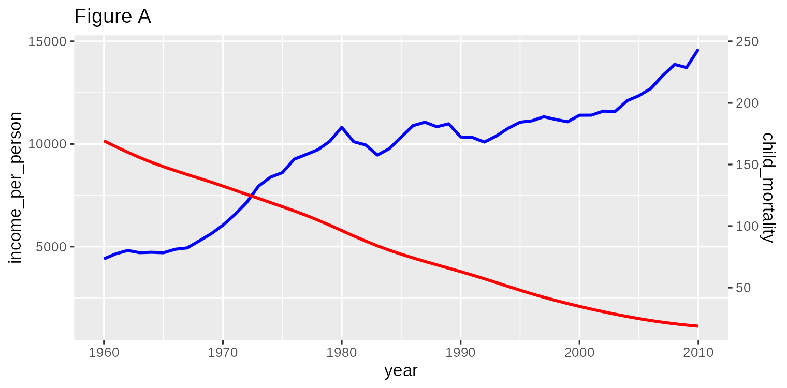
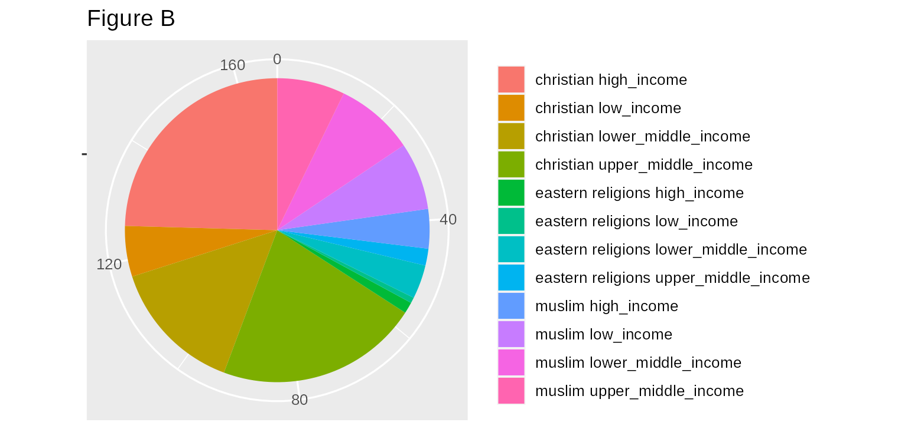
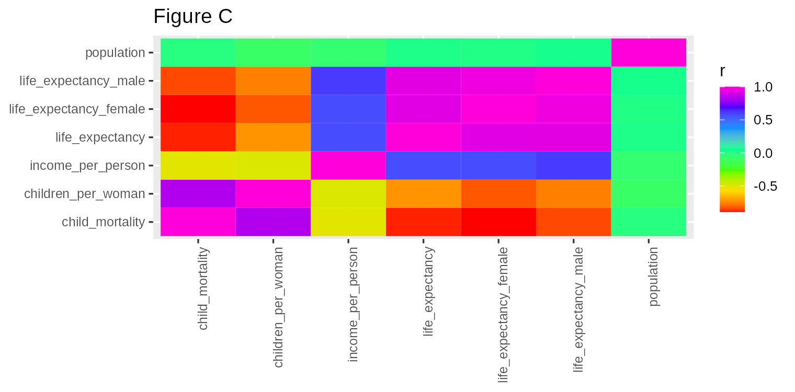
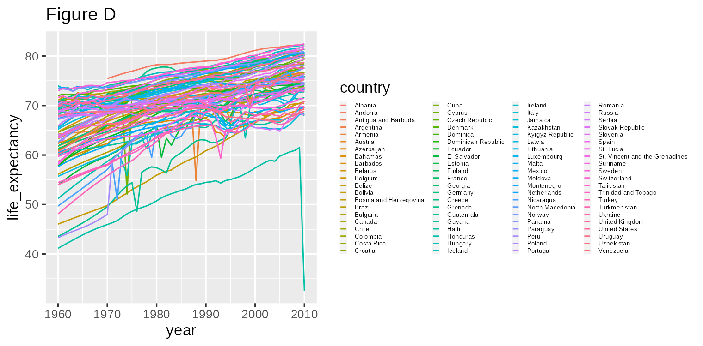
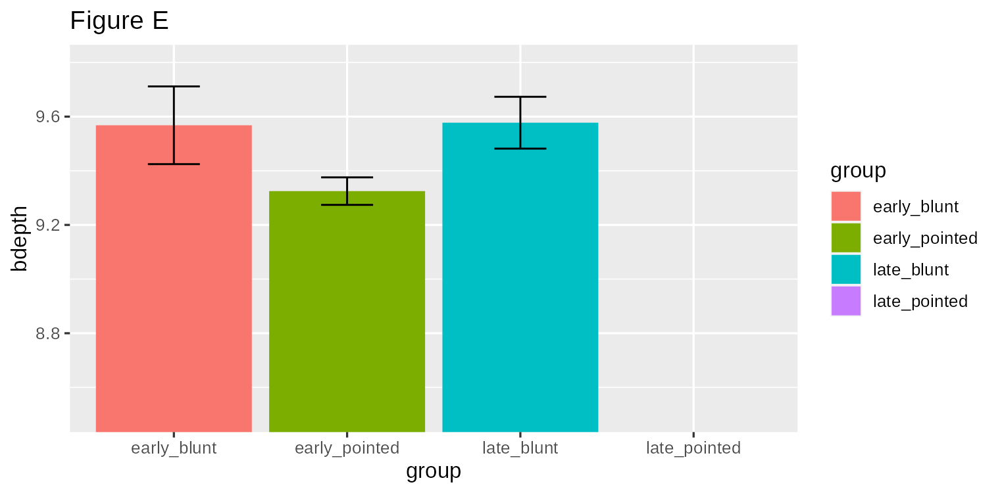
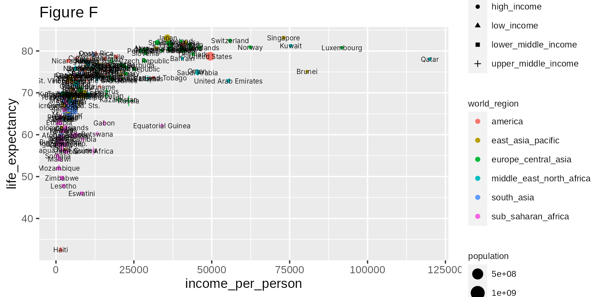

# Critique gallery {.unnumbered}

Every figure on this page was made with default settings and a few poor choices. Use them to practise the [five questions](checklist.qmd), or choose one for the [makeover challenge](../materials/makeover-challenge.qmd). All of them use the course data, so you can remake any of them.

For each figure, try to answer before opening the notes:

1. What is the message, if there is one?
2. What is the single change that would help most?
3. Which chapter of the course would help?

## Figure A: Income and child mortality in Brazil

Data: `gapminder_1960_2010.csv`

::: {.callout-answer collapse="true"}
- Two unrelated y axes: the point where the lines cross means nothing, because it depends on how each scale was chosen.
- Raw variable names as axis labels, and no title or message.
- Better: two aligned panels sharing the time axis. See [Honest scales and axes](../materials/scales-and-axes.qmd#avoid-dual-axes).
:::

## Figure B: Countries by religion and income group

Data: `gapminder_2010.csv`

::: {.callout-answer collapse="true"}
- A pie with twelve slices, many of similar size, which we cannot compare by angle.
- The legend combines two variables, so the colours cannot be decoded.
- Better: a stacked or grouped bar chart, or small multiples by religion. See [Ranking and ordering](../materials/ranking.qmd#parts-of-a-whole).
:::

## Figure C: Correlations between Gapminder variables

Data: `gapminder_2010.csv`

::: {.callout-answer collapse="true"}
- A rainbow palette for a correlation, which needs a diverging palette centred on zero.
- Variables in no meaningful order, with rotated raw labels.
- Better: a diverging palette with limits of -1 and 1, values written in the tiles, and readable labels. See [Colour with purpose](../materials/colour.qmd#diverging-colours).
:::

## Figure D: Life expectancy in the Americas and Europe

Data: `gapminder_1960_2010.csv`

::: {.callout-answer collapse="true"}
- A spaghetti plot with a legend of over 80 countries: impossible to follow any line.
- Better: highlight a few countries in context, or use small multiples. See [Change over time](../materials/change-over-time.qmd#too-many-lines).
:::

## Figure E: Beak depth in four groups of finches

Data: `finches.csv`

::: {.callout-answer collapse="true"}
- Bars of means with standard errors hide the data.
- The y axis is truncated, so the bars exaggerate small differences.
- The colour repeats the x axis, and one group appears to be missing because its bar falls outside the truncated axis.
- Better: show every point with the mean. See [Distributions](../materials/distributions.qmd#show-the-data-not-just-the-mean).
:::

## Figure F: Income and life expectancy

Data: `gapminder_2010.csv`

::: {.callout-answer collapse="true"}
- Four channels at once: position, size, colour and shape, plus every country labelled.
- Heavy overplotting in the bottom left, because income is on a linear scale.
- Better: a log scale, one highlighted group, and labels only for countries that matter to the message. See [Relationships](../materials/relationships.qmd).
:::

